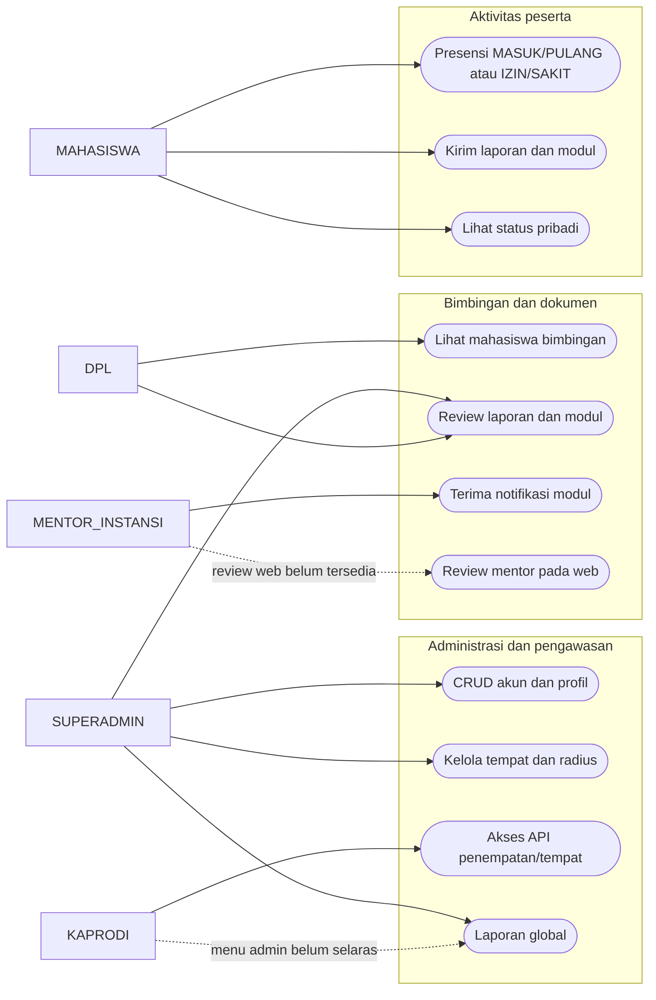
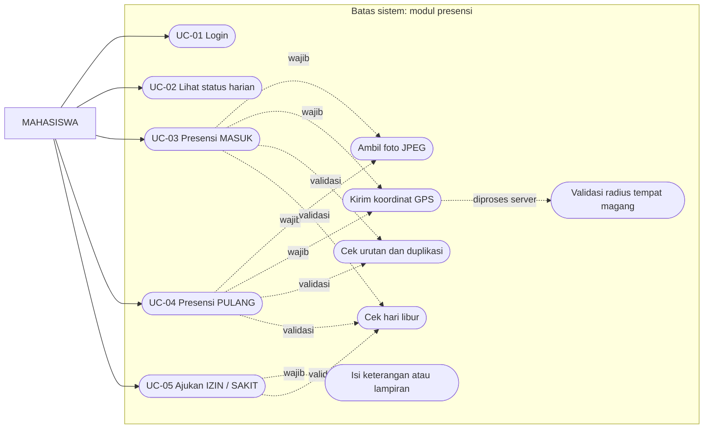
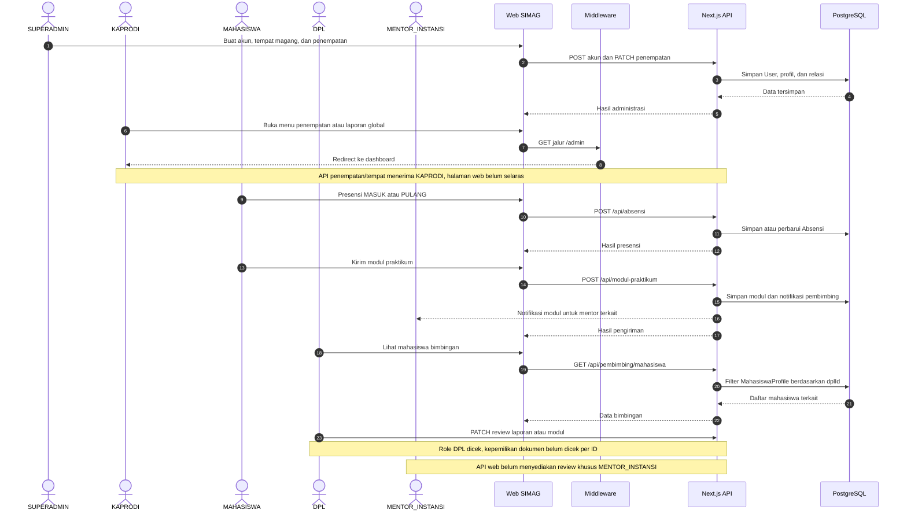
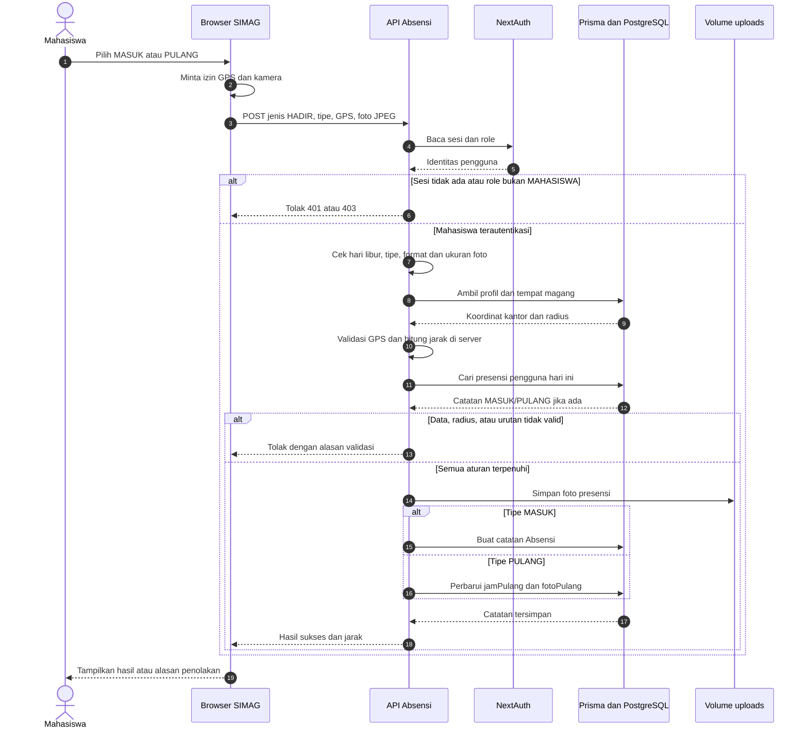
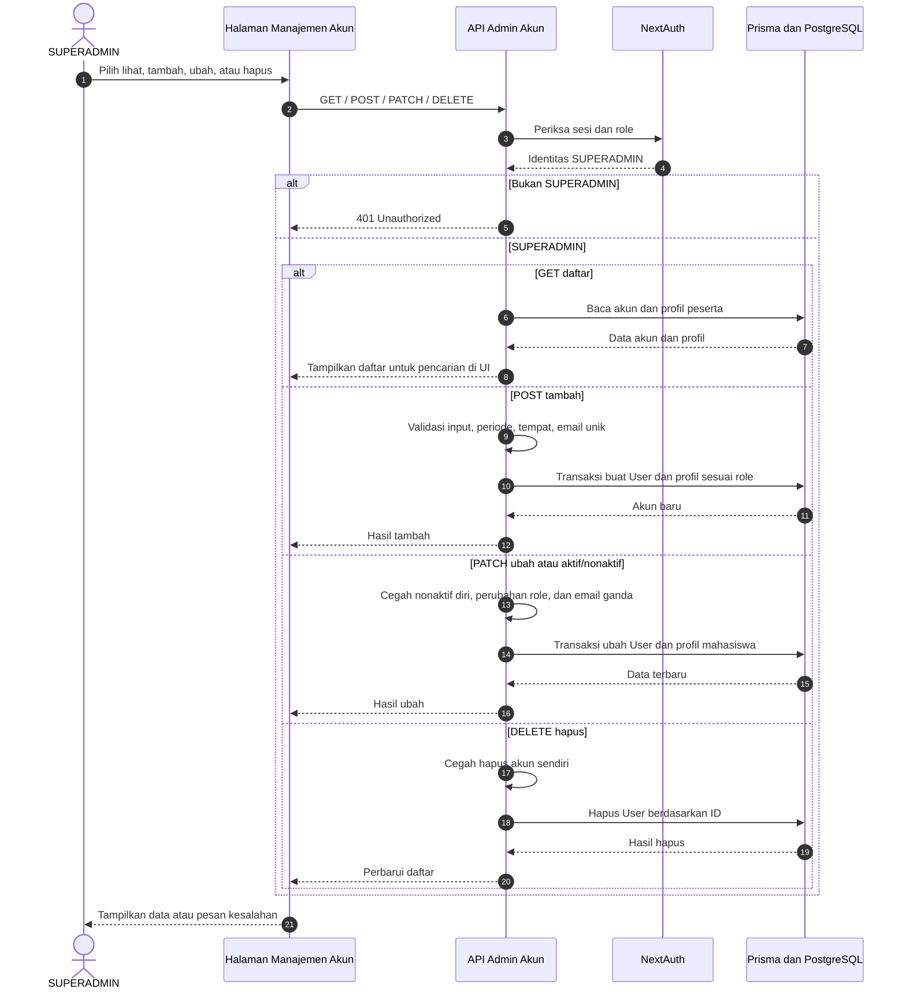
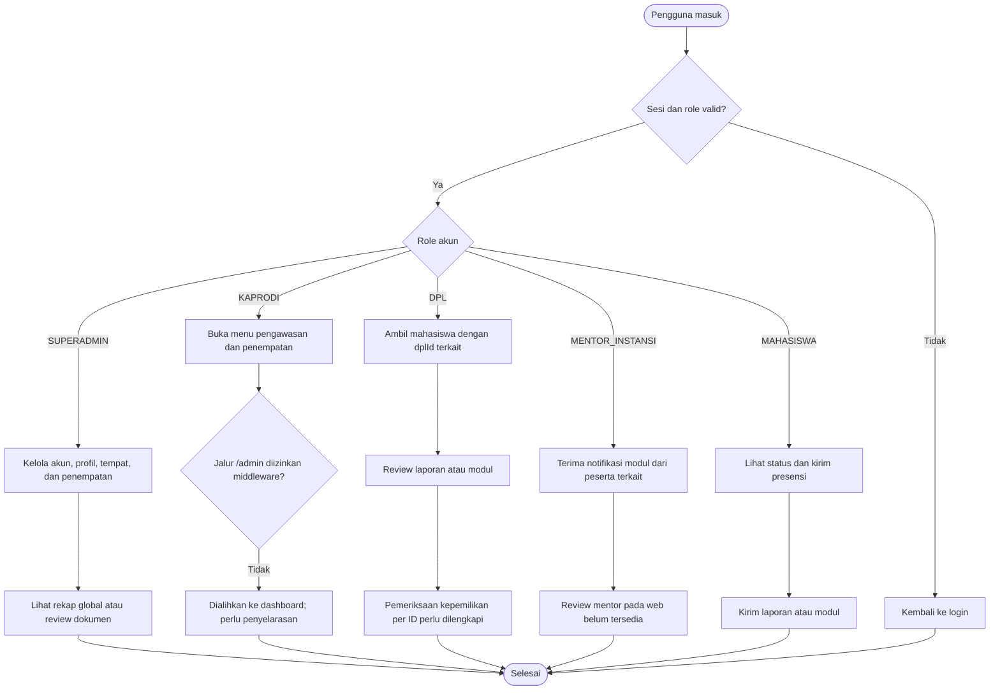
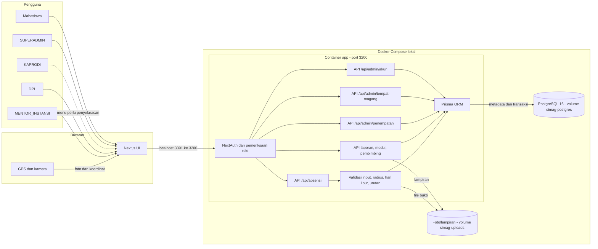
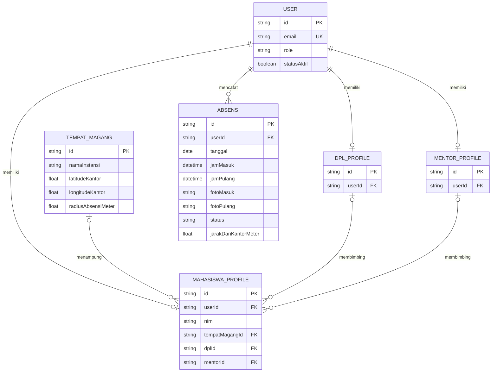
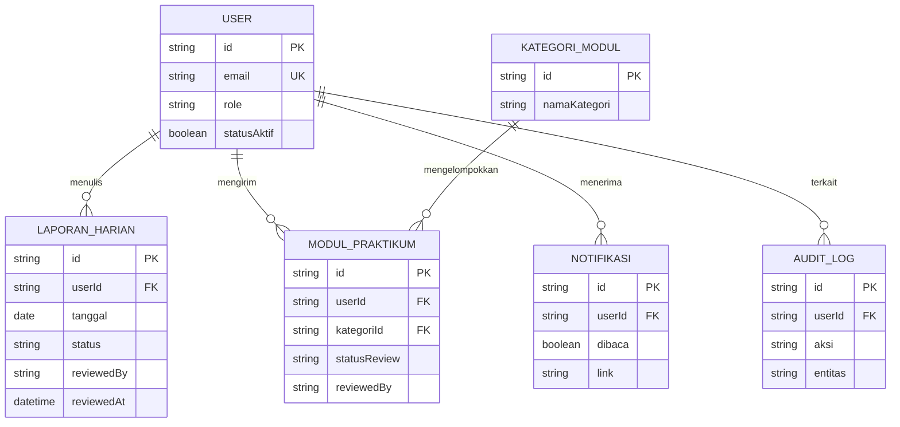

# SIMAG — Analisis dan Pengujian Sistem IF7A

**Topik:** Modul Presensi Magang Berbasis Geolokasi dan Bukti Foto pada Sistem Informasi Manajemen Magang (SIMAG)

| Identitas | Keterangan |
|---|---|
| Mata kuliah | Analisis dan Pengujian Sistem |
| Kelas | IF7A |
| Ketua kelompok | Muhammad Arif Rivandi — NIM: **23EO10005** |
| Anggota | Mohammad Alwan Abbas Abdillah — NIM: **23EO10030** |
| Anggota | Ian Alfian — NIM: **23EO1039** |
| Anggota | Fattatunnida Amalia Rahma — NIM: **23EO10010** |
| Anggota | Zainul Mutawakkil — NIM: **23EO10003** |

## 1. Deskripsi Proyek (20 poin)

Repositori ini berisi kode dan rancangan SIMAG untuk mengelola kegiatan magang. Ruang lingkup final project pada mata kuliah ini adalah **presensi mahasiswa berbasis lokasi dan foto**, serta **pengelolaan data peserta dan tempat magang oleh Admin**. Masalah yang ditangani adalah pencatatan masuk/pulang, pembuktian lokasi dalam radius tempat magang, pengajuan izin/sakit, dan pencegahan data presensi yang tidak lengkap atau ganda.

SIMAG bukan program sederhana; sistem ini memiliki autentikasi, beberapa role, API, penyimpanan PostgreSQL, dan modul administrasi. Fokus pengujian tetap dibatasi pada alur presensi dan CRUD peserta. Lima role pada skema adalah `SUPERADMIN`, `KAPRODI`, `DPL`, `MENTOR_INSTANSI`, dan `MAHASISWA`. Dua aktor utama untuk alur yang dibahas adalah **Mahasiswa** dan **SUPERADMIN**; kemampuan role lain belum seluruhnya diverifikasi.

**Status dokumen:** diagram memadukan rancangan final project dengan kode dan bukti pengujian pada workspace lokal. Sebagian perubahan implementasi lokal belum ikut terunggah ke branch `main` GitHub. Uraian role pendukung menunjukkan kondisi dan celah yang ditemukan, bukan klaim bahwa seluruh alurnya telah lulus uji.

### Manajemen role dan otorisasi

Role disimpan sebagai enum pada kolom User.role. Sistem memakai lima nilai: SUPERADMIN, KAPRODI, DPL, MENTOR_INSTANSI, dan MAHASISWA. **Tidak ada pewarisan hak akses otomatis** antarrole: setiap halaman dan API perlu memeriksa role yang diizinkan. Pada proses login, NextAuth memvalidasi identitas, password hash, dan statusAktif, lalu menyimpan id serta role pada sesi JWT. Menu yang terlihat di Sidebar atau Dock hanya navigasi; izin sebenarnya harus ditegakkan kembali di halaman server dan route handler.

Saat SUPERADMIN membuat akun melalui API, data User dan profil yang diperlukan dibuat dalam transaksi. MAHASISWA memperoleh MahasiswaProfile, DPL memperoleh DplProfile, dan MENTOR_INSTANSI memperoleh MentorProfile. KAPRODI dan SUPERADMIN menggunakan User.role tanpa tabel profil khusus. Role akun tidak dapat diganti melalui PATCH setelah dibuat; akun dapat diaktifkan/nonaktifkan, sementara hapus dan nonaktifkan akun sendiri ditolak oleh API akun.

| Role | Alur yang terlihat pada kode | Batas dan status yang perlu dijelaskan saat demo |
|---|---|---|
| SUPERADMIN | CRUD akun/profil peserta, penempatan, tempat magang, rekap global, serta review laporan/modul. | CRUD peserta telah tercatat lulus smoke API; interaksi UI dan hak akses modul lain belum diuji menyeluruh. |
| KAPRODI | API penempatan dan tempat magang mengizinkan role ini; menu juga menampilkan kedua modul dan laporan global. | Middleware memblokir seluruh jalur /admin bagi selain SUPERADMIN. Halaman penempatan dan laporan global serta API laporan global juga masih membatasi SUPERADMIN. Alur web KAPRODI belum selaras. |
| DPL | Dapat mengambil daftar mahasiswa yang terhubung melalui MahasiswaProfile.dplId; endpoint review laporan/modul menerima role DPL. | Endpoint review per ID belum membuktikan bahwa dokumen milik mahasiswa bimbingannya. Pembatasan kepemilikan harus diperbaiki dan diuji. |
| MENTOR_INSTANSI | Profil mentor terhubung lewat MahasiswaProfile.mentorId; pengiriman modul membuat notifikasi bagi mentor terkait. | Review laporan/modul pada API web saat ini hanya mengizinkan DPL dan SUPERADMIN. Alur review khusus mentor belum tersedia/terverifikasi. |
| MAHASISWA | API presensi menegakkan role MAHASISWA; peserta dapat melihat data sendiri serta mengirim laporan dan modul. | Beberapa API laporan/modul baru memeriksa sesi, bukan role MAHASISWA secara khusus. Akses dan pembatasan data lintasrole masih perlu diaudit. |

Pemeriksaan role dilakukan pada tiga lapisan yang perlu konsisten: **navigasi UI**, **middleware/halaman server**, dan **API**. Middleware tidak mencakup jalur /api, sehingga setiap route handler bertanggung jawab sendiri atas otorisasi. Sesi memakai JWT dengan masa berlaku satu jam; perubahan statusAktif diperiksa saat login, sedangkan pencabutan sesi aktif segera setelah akun dinonaktifkan belum ditunjukkan oleh kode.

## 2. Desain Proyek (UML) (20 poin)

Diagram di bawah menjabarkan **alur final project**: presensi mahasiswa dan pengelolaan peserta/lokasi. Lima role akun tetap dicatat agar cakupan sistem jelas. Garis putus-putus pada use case menunjukkan langkah yang menjadi bagian dari use case lain atau fungsi role pendukung yang belum diverifikasi menyeluruh. Diagram use case ditulis sebagai representasi Mermaid agar dapat dibaca langsung di GitHub.

### 2.1 Use case menyeluruh — lima role

Diagram ini menempatkan semua role dalam sistem. Garis penuh berarti jalur atau data terkait ditemukan pada kode; garis putus-putus menunjukkan alur yang masih perlu penyelarasan atau verifikasi. Diagram rinci setelahnya memecah presensi dan administrasi agar tetap terbaca.

### 2.2 Use case — presensi mahasiswa

Untuk HADIR, foto dan GPS wajib. Server menghitung jarak terhadap lokasi tempat magang yang tersimpan pada profil peserta. Presensi PULANG hanya dapat dilakukan sesudah MASUK dan sebelum PULANG lain tercatat pada hari yang sama. IZIN/SAKIT memerlukan keterangan **atau** lampiran; GPS tidak diwajibkan oleh API untuk kedua jenis itu.

### 2.3 Use case — administrasi peserta dan lokasi

Endpoint akun membatasi operasi CRUD kepada SUPERADMIN. Endpoint tempat magang mengizinkan SUPERADMIN dan KAPRODI; akses KAPRODI pada halaman web belum dinyatakan lulus uji. Perubahan role akun setelah dibuat ditolak agar profil terkait tetap konsisten.

### 2.4 Sequence diagram — siklus lintas lima role

Sequence ini memperlihatkan interaksi lima role dalam satu siklus magang. Catatan pada lifeline menandai bagian yang belum konsisten; keberadaan langkah di diagram tidak berarti seluruh alur sudah lulus uji.

### 2.5 Sequence diagram — presensi HADIR

File foto saat ini ditulis sebelum operasi database. Jika penyimpanan database gagal setelah file berhasil ditulis, pembersihan file yatim masih perlu ditangani; diagram menunjukkan urutan kode saat ini, bukan transaksi file dan database yang atomik.

### 2.6 Sequence diagram — CRUD peserta oleh SUPERADMIN

Pencarian peserta berlangsung pada daftar yang diterima UI; endpoint GET membaca daftar akun. Validasi gagal menghasilkan respons kesalahan dan tidak boleh ditafsirkan sebagai operasi berhasil.

### 2.7 Activity diagram — keputusan berdasarkan role

### 2.8 Activity diagram — keputusan presensi

**Status pengujian:** alur ini menggambarkan aturan pada implementasi lokal. Penolakan tanpa GPS dan di luar radius sudah tercatat dalam smoke test. Alur berhasil dengan GPS/kamera perangkat nyata, interaksi UI Admin, serta hak akses seluruh role masih perlu diuji tersendiri.

## 3. Arsitektur Proyek (20 poin)

### 3.1 Komponen dan jalur data

Browser meminta izin lokasi dan kamera. API memeriksa sesi dan role, lalu memvalidasi data sebelum Prisma mengakses PostgreSQL. Foto dan lampiran disimpan di volume terpisah; database menyimpan path serta metadata. Port **3391** hanya terikat ke host lokal dalam konfigurasi Docker Compose pengembangan.

### 3.2 Model data inti untuk final project

Satu pengguna dapat memiliki profil sesuai role. Satu peserta ditempatkan pada paling banyak satu tempat magang aktif dalam model ini. Tabel Absensi memiliki batas unik untuk pasangan pengguna dan tanggal, sehingga satu catatan harian dapat memuat jam MASUK dan PULANG.

### 3.3 Rincian database, relasi, dan integritas data

PostgreSQL 16 menyimpan data relasional; Prisma 7 memetakan model pada [prisma/schema.prisma](prisma/schema.prisma) ke tabel. User adalah sumber identitas dan role. Profil khusus dipisah agar atribut NIM, NIP, mentor, serta penempatan tidak dicampur ke setiap akun. KAPRODI dan SUPERADMIN tidak memiliki tabel profil khusus; keduanya dibedakan oleh User.role.

| Model / tabel | Kunci dan relasi penting | Fungsi |
|---|---|---|
| User / users | id sebagai PK; email dan username unik; role dan statusAktif | Identitas login untuk semua role. Password disimpan sebagai hash, bukan teks biasa. |
| MahasiswaProfile / mahasiswa_profiles | userId unik ke User; dplId, mentorId, tempatMagangId boleh kosong | Data peserta, NIM, prodi, periode, kontak, pembimbing, dan lokasi magang aktif. |
| DplProfile / dpl_profiles | userId unik ke User | Identitas DPL; satu DPL dapat terhubung ke banyak MahasiswaProfile. |
| MentorProfile / mentor_profiles | userId unik ke User | Identitas mentor instansi; satu mentor dapat membimbing banyak peserta. |
| TempatMagang / tempat_magang | id sebagai PK; direferensikan MahasiswaProfile | Nama/alamat instansi, titik GPS kantor, dan radiusAbsensiMeter. |
| Absensi / absensi | userId ke User; pasangan userId + tanggal unik | Satu catatan harian berisi status, MASUK/PULANG, GPS, jarak, serta path foto/lampiran. |
| LaporanHarian / laporan_harian | userId ke User | Catatan kegiatan dan status review beserta reviewer/waktu review. |
| ModulPraktikum / modul_praktikum | userId ke User; kategoriId ke KategoriModul | Dokumen tugas praktikum, status review, dan lampiran. |
| Notifikasi / notifikasi | userId ke User | Pesan untuk pembimbing/mentor, misalnya saat modul peserta dikirim. |
| Session dan AuditLog | Keduanya terhubung ke User | Struktur untuk sesi/audit tersedia pada skema; sesi web saat ini memakai JWT dan penulisan audit tidak boleh diasumsikan terjadi di semua aksi. |

**Kardinalitas dan alur baca:** User MAHASISWA memiliki paling banyak satu MahasiswaProfile. Profil tersebut menunjuk paling banyak satu tempat magang, satu DPL, dan satu mentor pada suatu waktu; masing-masing pembimbing atau tempat magang dapat menangani banyak peserta. Absensi, LaporanHarian, dan ModulPraktikum mereferensikan User secara langsung. Saat presensi, API mengambil MahasiswaProfile beserta TempatMagang, menghitung jarak GPS terhadap latitudeKantor/longitudeKantor, membandingkannya dengan radiusAbsensiMeter, lalu membaca Absensi untuk tanggal Jakarta sebelum membuat catatan MASUK atau memperbarui PULANG.

**Aturan integritas dan batas model:**

1. Unique constraint pada User.email, User.username, dan setiap profil.userId mencegah duplikasi identitas/profil. Constraint gabungan Absensi(userId, tanggal) mencegah lebih dari satu baris presensi harian per akun.
2. NIM pada MahasiswaProfile bersifat opsional dan **belum diberi unique constraint** pada skema. Validasi NIM unik, bila menjadi aturan kampus, masih perlu dirancang dan diuji.
3. Relasi User ke profil, presensi, laporan, modul, dan beberapa data turunannya memakai onDelete: Cascade. Hapus fisik akun dapat ikut menghapus riwayat terkait; statusAktif menyediakan alternatif menonaktifkan akun tanpa menghapus barisnya.
4. Penempatan saat ini disimpan sebagai foreign key pada MahasiswaProfile. Tidak ada tabel riwayat penempatan terpisah, sehingga perpindahan DPL/mentor/tempat tidak otomatis meninggalkan histori relasi lama.
5. reviewedBy pada laporan/modul adalah kolom String opsional, bukan foreign key Prisma ke User. Pemeriksaan reviewer dan pembatasan mahasiswa bimbingan perlu ditegakkan di aplikasi.
6. Foto presensi dan lampiran disimpan pada volume simag-uploads, sedangkan database hanya menyimpan path file. Backup database saja tidak cukup untuk memulihkan seluruh bukti.
7. Tidak ada @@index tambahan untuk dplId, mentorId, tempatMagangId, atau tanggal laporan pada skema saat ini. Kebutuhan indeks harus dievaluasi dari ukuran data dan pola query sebelum dipakai pada skala lebih besar.

### 3.4 ERD dokumen, review, dan notifikasi

ERD ini memperlihatkan relasi yang didefinisikan pada skema, bukan jaminan bahwa setiap alur review atau audit sudah berjalan. Kolom reviewedBy sengaja tidak digambar sebagai garis relasi karena skema belum mendeklarasikan foreign key untuknya.

## 4. Tech Stack (20 poin)

| Lapisan | Teknologi yang dipakai |
|---|---|
| Frontend | Next.js 16, React 19, TypeScript, Tailwind CSS 4 |
| Backend/API | Next.js App Router dan Route Handlers, NextAuth untuk sesi web |
| Database | PostgreSQL 16, Prisma ORM 7 |
| Penyimpanan bukti | Volume file lokal pada Docker untuk foto/lampiran |
| Pengembangan | Node.js 22 pada image Docker, Docker Compose, Git/GitHub |

Contoh Flutter, Go, MongoDB, dan Supabase pada template tugas **bukan** stack proyek ini.

## 5. Repositori, Pengujian, dan Demo UTS (20 poin)

- Repositori: [Heat4Cliff/simag-bmkg-web](https://github.com/Heat4Cliff/simag-bmkg-web).
- Ketua kelompok bertanggung jawab mengunggah versi yang disepakati dan memimpin demonstrasi UTS.
- Bukti lokal yang telah dicatat: **8/8 unit test** dan **9/9 pemeriksaan smoke API** lulus. Smoke test mencakup CRUD peserta, penolakan presensi tanpa GPS, dan penolakan lokasi di luar radius.
- Pemeriksaan yang masih diperlukan: presensi di dalam radius dengan GPS dan kamera nyata, interaksi UI Admin, serta hak akses seluruh lima role.

Alur demo: jalankan aplikasi melalui Docker di `http://localhost:3391`, tampilkan role dan data dummy, jelaskan diagram, demonstrasikan CRUD peserta serta validasi presensi yang sudah teruji, lalu tunjukkan hasil uji dan batasnya. Status **PASS** pada pengujian lokal tidak berarti seluruh fitur SIMAG telah lulus uji.
