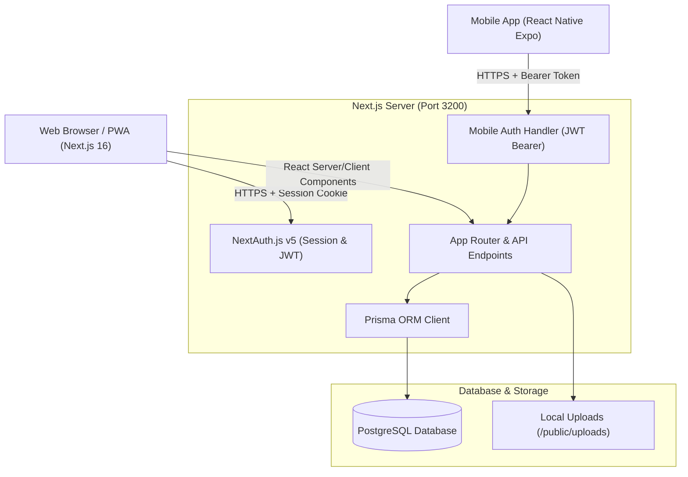
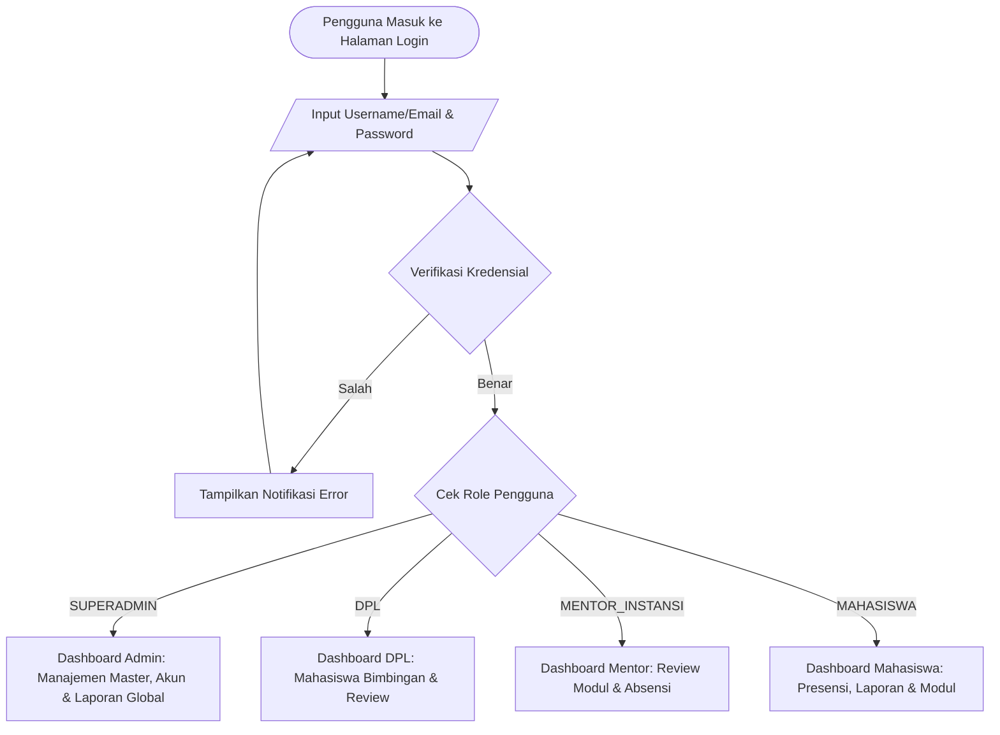
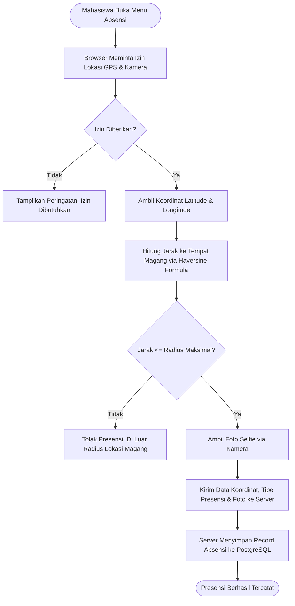
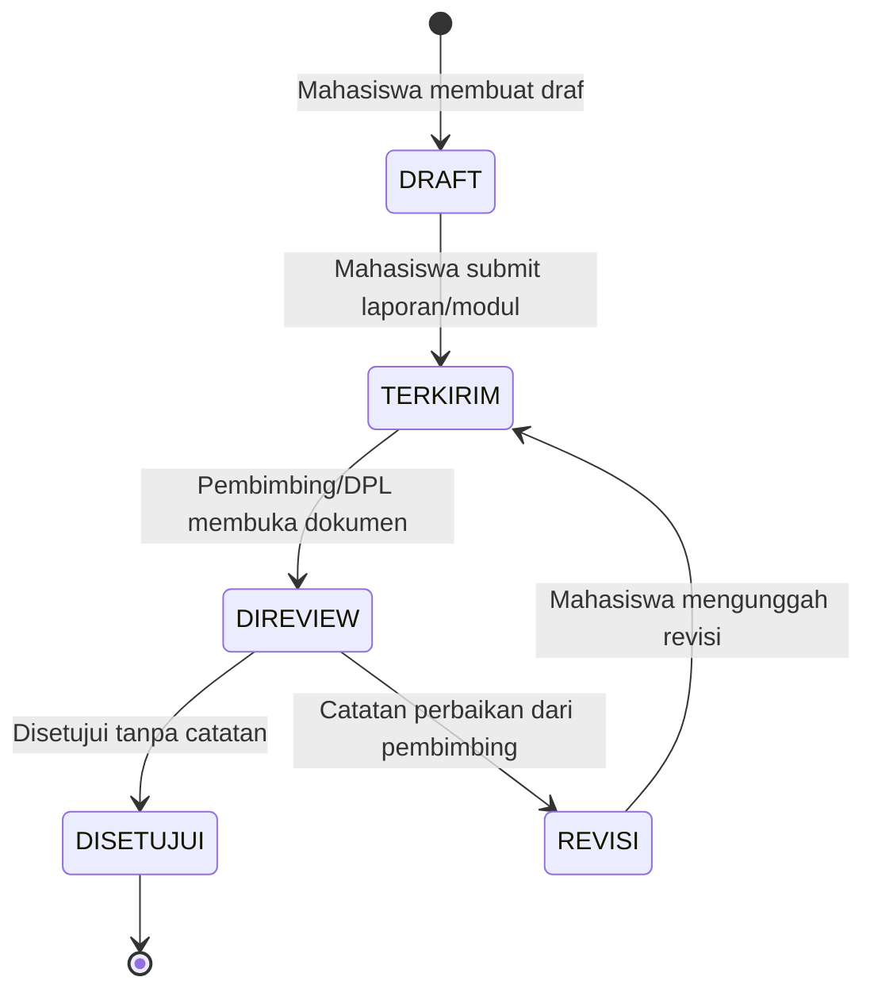
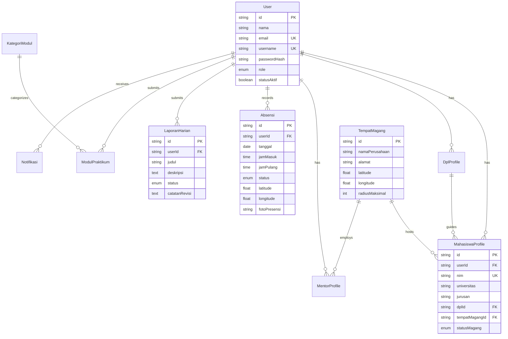

# SIMAG UNUGHA (Web Platform)

[](https://nextjs.org/)
[](https://reactjs.org/)
[](https://www.prisma.io/)
[](https://www.postgresql.org/)
[](https://tailwindcss.com/)

**Sistem Informasi Manajemen Magang (SIMAG)** adalah aplikasi berbasis web yang dirancang khusus untuk mengelola, memantau, dan mendokumentasikan seluruh siklus magang mahasiswa Universitas Nahdlatul Ulama Al Ghazali (UNUGHA) di Stasiun Meteorologi BMKG Cilacap serta instansi mitra lainnya.

---

## Daftar Isi
1. [Fitur Utama](#-fitur-utama)
2. [Arsitektur & Diagram Sistem](#-arsitektur--diagram-sistem)
   - [Arsitektur Sistem](#1-arsitektur-sistem)
   - [Flowchart Autentikasi & Multi-Role](#2-flowchart-autentikasi--multi-role)
   - [Activity Diagram: Presensi Berbasis Geolocation](#3-activity-diagram-presensi-berbasis-geolocation)
   - [State Diagram: Siklus Laporan & Modul](#4-state-diagram-siklus-laporan--modul-praktikum)
   - [Entity Relationship Diagram (ERD)](#5-entity-relationship-diagram-erd)
3. [State Management](#-state-management)
4. [Teknologi & Dependensi](#-teknologi--dependensi)
5. [Persyaratan Sistem (Prerequisites)](#-persyaratan-sistem-prerequisites)
6. [Panduan Instalasi & Penggunaan](#-panduan-instalasi--penggunaan)
7. [Struktur Folder](#-struktur-folder)
8. [Script Perintah (NPM Scripts)](#-script-perintah-npm-scripts)

---

## 🌟 Fitur Utama

- **Multi-Role RBAC (Role-Based Access Control)**:
  - `SUPERADMIN`: Manajemen data master, instansi tempat magang, penempatan mahasiswa, pengelolaan akun, dan rekapitulasi data (Laporan Global & Dashboard Eksekutif).
  - `DPL (Dosen Pembimbing Lapangan)`: Pemantauan kehadiran, bimbingan, revisi laporan harian, penilaian modul bimbingan.
  - `MENTOR_INSTANSI`: Evaluasi praktikum harian instansi dan validasi presensi di lokasi mitra.
  - `MAHASISWA`: Presensi masuk/pulang berbasis geolokasi & selfie, upload laporan harian, pengumpulan modul praktikum, dan agenda kalender.
- **Geofenced & Selfie Attendance**: Presensi masuk dan keluar yang memvalidasi radius GPS instansi (Haversine formula) serta verifikasi wajah (webcam/kamera).
- **Manajemen Modul Praktikum & Laporan Harian**: Alur kerja penyerahan tugas terstruktur (`DRAFT` $\rightarrow$ `TERKIRIM` $\rightarrow$ `DIREVIEW` $\rightarrow$ `DISETUJUI` / `REVISI`).
- **Ekspor Dokumen Otomatis**: Generate rekap dokumen Word (`.docx`) dan tabel rekap data secara instan.
- **Web Push Notifications**: Notifikasi instan PWA menggunakan VAPID Web Push.
- **Mobile Companion Ready**: Dilengkapi REST API khusus (`/api/mobile/*`) dengan otentikasi JWT dan CORS untuk integrasi aplikasi mobile.

---

## 📐 Arsitektur & Diagram Sistem

### 1. Arsitektur Sistem


### 2. Flowchart Autentikasi & Multi-Role


### 3. Activity Diagram: Presensi Berbasis Geolocation


### 4. State Diagram: Siklus Laporan & Modul Praktikum


### 5. Entity Relationship Diagram (ERD)


---

## 🧠 State Management

Aplikasi web ini menggunakan kombinasi state management modern:

1. **Server State & Caching**: **`@tanstack/react-query` (v5)**
   - Diatur melalui `QueryClientProvider` di `src/app/providers.tsx`.
   - Mengelola pemanggilan data asynchronous dari backend, sinkronisasi cache, auto refetching, serta invalidasi data otomatis setelah mutasi data (misalnya setelah submit absensi atau ganti status laporan).
   - Pengaturan cache default: `staleTime: 60 * 1000` (1 menit) dengan `retry: 1`.

2. **Session / Auth State**: **`next-auth` (v5 Beta) + `SessionProvider`**
   - Mengelola state login pengguna, token otentikasi JWT, informasi role, serta profil pengguna yang aktif di seluruh pohon komponen React.

3. **Form State**: **`react-hook-form` + `@hookform/resolvers/zod`**
   - Menangani state validasi formulir kompleks (seperti data master akun, form laporan, dan ganti password) tanpa memicu render ulang yang tidak perlu.

4. **Component State**: **`React 19 Hooks` (`useState`, `useCallback`, `useMemo`)**
   - Digunakan untuk kontrol antarmuka lokal seperti modal, dropdown filter, dan status upload file.

---

## 🛠 Teknologi & Dependensi

| Kategori | Teknologi | Deskripsi |
|---|---|---|
| **Framework** | Next.js 16 (App Router) | Fullstack React framework dengan Turbopack/Webpack support |
| **Library UI** | React 19 | Library UI reaktif utama |
| **Database ORM** | Prisma 7.9 | ORM type-safe untuk PostgreSQL |
| **Database Engine**| PostgreSQL 16+ | Sistem basis data relasional utama |
| **Styling** | Tailwind CSS v4 | Utility-first CSS framework |
| **Charts** | ApexCharts & Recharts | Visualisasi analitik kehadiran dan statistik laporan |
| **Export Tool** | docx | Generator dokumen Microsoft Word otomatis |
| **Push Service** | web-push | Web Push Notification via VAPID standard |

---

## 📋 Persyaratan Sistem (Prerequisites)

Sebelum menjalankan aplikasi, pastikan perangkat Anda telah terpasang:
- **Node.js**: Versi `20.x` atau lebih baru (`node -v`)
- **NPM**: Versi `10.x` atau lebih baru (`npm -v`)
- **PostgreSQL**: Versi `14+` yang sedang aktif (`psql --version`)
- **Git**: Untuk clone repositori (`git --version`)

---

## 🚀 Panduan Instalasi & Penggunaan

### 1. Clone Repositori
```bash
git clone https://github.com/Heat4Cliff/simag-bmkg-web.git
cd simag-bmkg-web
```

### 2. Pasang Dependensi
```bash
npm install
```

### 3. Konfigurasi Variabel Lingkungan
Salin contoh file konfigurasi lingkungan atau buat file `.env`:
```bash
cp .env.example .env
```
Sesuaikan konfigurasi koneksi database PostgreSQL dan secret key Anda pada `.env`.

### 4. Setup Basis Data (Prisma)
Jalankan migrasi schema dan buat Prisma Client:
```bash
# Sinkronkan schema ke PostgreSQL
npx prisma db push

# Generate client Prisma terbaru
npx prisma generate

# (Opsional) Jalankan data dummy awal
npx prisma db seed
```

### 5. Jalankan Aplikasi
**Mode Pengembangan (Development):**
```bash
npm run dev
```
Buka peramban di [http://localhost:3200](http://localhost:3200) atau sesuai port yang ditentukan.

**Mode Produksi (Production Build):**
```bash
npm run build
npm run start
---

## 📁 Struktur Folder

```text
simag-bmkg/
├── prisma/
│   ├── schema.prisma          # Definisi model basis data & relasi
│   └── seed.ts                # Data awalan akun dan tempat magang
├── public/
│   ├── uploads/               # Folder penyimpanan berkas statis & foto selfie
│   └── ...                    # Aset grafis & logo
├── src/
│   ├── app/
│   │   ├── (auth)/login/      # Halaman autentikasi masuk
│   │   ├── absensi/           # Halaman presensi & rekap pribadi
│   │   ├── admin/             # Modul admin (akun, penempatan, tempat magang)
│   │   ├── api/               # API routes Next.js
│   │   │   ├── admin/         # CRUD data master admin
│   │   │   ├── mobile/        # REST API khusus aplikasi mobile
│   │   │   └── ...            # Endpoint absensi, modul, notifikasi
│   │   ├── dashboard/         # Halaman dashboard multi-role
│   │   ├── laporan-harian/    # Modul pelaporan kegiatan harian
│   │   ├── modul-praktikum/   # Modul tugas/praktikum per topik
│   │   └── providers.tsx      # QueryClient & SessionProvider wrapper
│   ├── components/            # Komponen reaktif (UI, Grafik, Form, Tabel)
│   ├── lib/                   # Utilitas (Prisma client, JWT helper, Auth options)
│   └── middleware.ts          # Route guard & proteksi RBAC
└── package.json
```

---

## 📜 Script Perintah (NPM Scripts)

- `npm run dev` : Menjalankan server lokal pengembangan.
- `npm run build` : Mengompilasi proyek Next.js untuk rilis produksi.
- `npm run start` : Menjalankan server aplikasi Next.js dalam mode produksi.
- `npm run db:push` : Mengaplikasikan perubahan skema Prisma ke database tanpa file migrasi.
- `npm run db:studio` : Membuka antarmuka grafis Prisma Studio untuk mengelola tabel basis data.
- `npm run db:seed` : Mengisi database dengan akun pengujian default.
