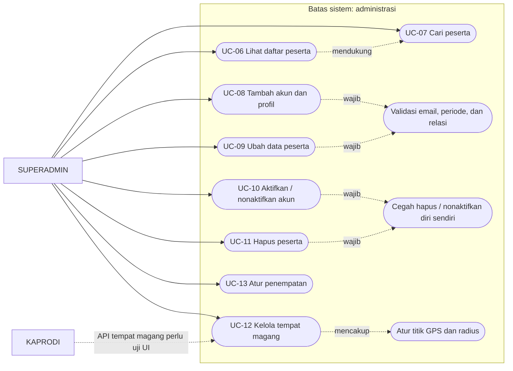
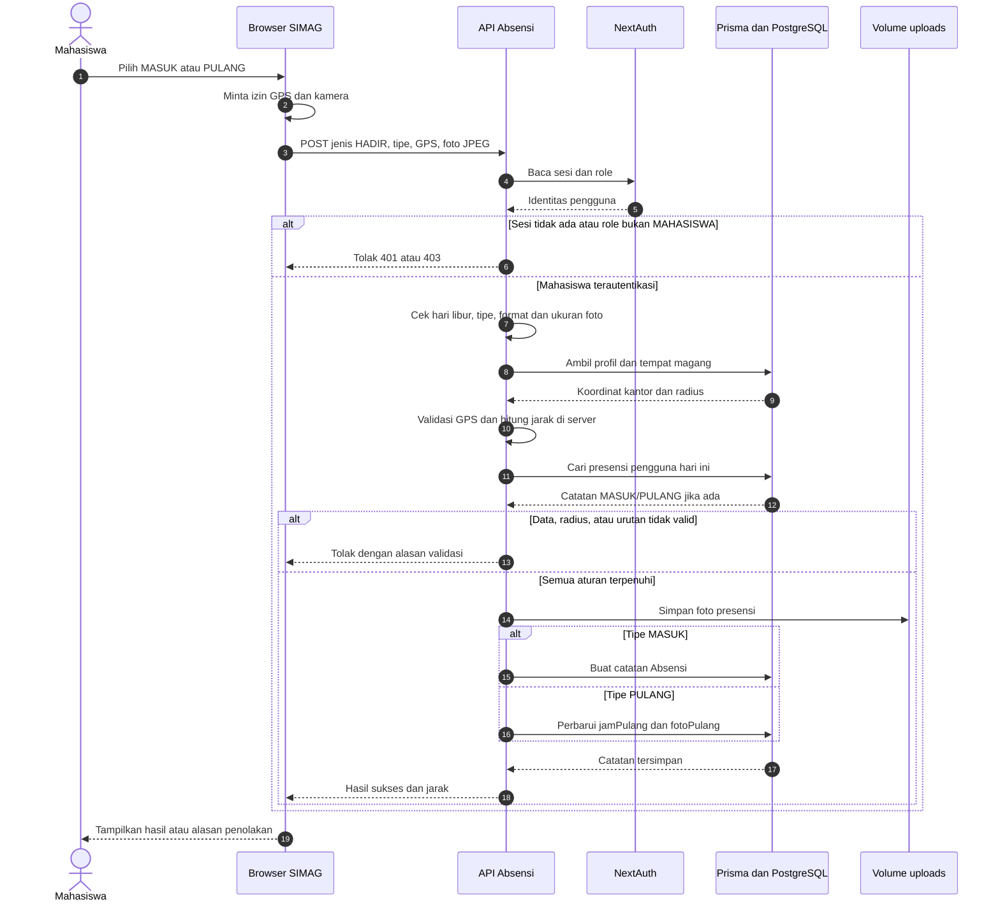
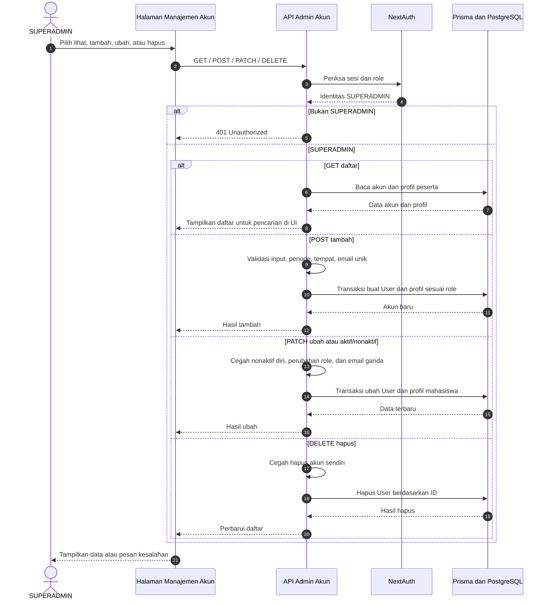
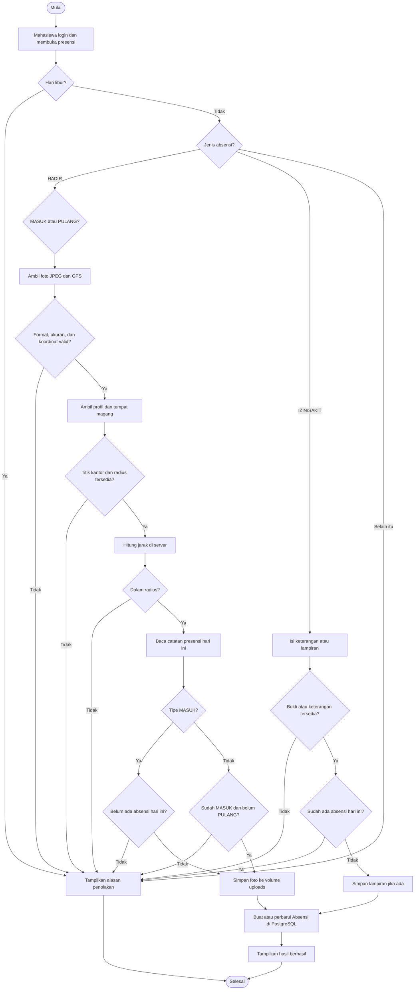
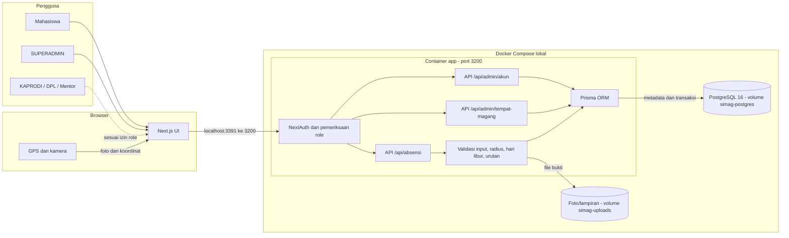
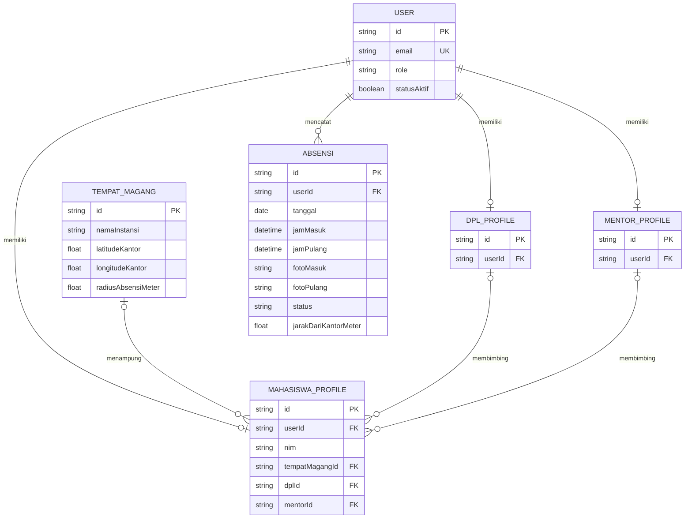

# SIMAG — Analisis dan Pengujian Sistem IF7A

**Topik:** Modul Presensi Magang Berbasis Geolokasi dan Bukti Foto pada Sistem Informasi Manajemen Magang (SIMAG)

| Identitas | Keterangan |
|---|---|
| Mata kuliah | Analisis dan Pengujian Sistem |
| Kelas | IF7A |
| Ketua kelompok | Muhammad Arif Rivandi — NIM: **23EO10005** |
| Anggota | Mohammad Alwan Abbas Abdillah — NIM: **23EO10030** |
| Anggota | Ian Alfian — NIM: **23EO1039** |
| Anggota | Fattatunnida Amalia Rahma — NIM: **23EO10010** |
| Anggota | Zainul Mutawakkil — NIM: **23EO10003** |

## 1. Deskripsi Proyek (20 poin)

Repositori ini berisi kode dan rancangan SIMAG untuk mengelola kegiatan magang. Ruang lingkup final project pada mata kuliah ini adalah **presensi mahasiswa berbasis lokasi dan foto**, serta **pengelolaan data peserta dan tempat magang oleh Admin**. Masalah yang ditangani adalah pencatatan masuk/pulang, pembuktian lokasi dalam radius tempat magang, pengajuan izin/sakit, dan pencegahan data presensi yang tidak lengkap atau ganda.

SIMAG bukan program sederhana; sistem ini memiliki autentikasi, beberapa role, API, penyimpanan PostgreSQL, dan modul administrasi. Fokus pengujian tetap dibatasi pada alur presensi dan CRUD peserta. Lima role pada skema adalah `SUPERADMIN`, `KAPRODI`, `DPL`, `MENTOR_INSTANSI`, dan `MAHASISWA`. Dua aktor utama untuk alur yang dibahas adalah **Mahasiswa** dan **SUPERADMIN**; kemampuan role lain belum seluruhnya diverifikasi.

## 2. Desain Proyek (UML) (20 poin)

Diagram di bawah menjabarkan **alur final project**: presensi mahasiswa dan pengelolaan peserta/lokasi. Lima role akun tetap dicatat agar cakupan sistem jelas. Garis putus-putus pada use case menunjukkan langkah yang menjadi bagian dari use case lain atau fungsi role pendukung yang belum diverifikasi menyeluruh. Diagram use case ditulis sebagai representasi Mermaid agar dapat dibaca langsung di GitHub.

| Role akun | Hubungan dengan ruang lingkup tugas |
|---|---|
| MAHASISWA | Aktor utama: melihat status, presensi MASUK/PULANG, serta mengajukan IZIN/SAKIT. |
| SUPERADMIN | Aktor utama: CRUD akun/profil peserta, penempatan, dan tempat magang. |
| KAPRODI | Role pengawasan akademik; API tempat magang mengenali role ini, tetapi keselarasan menu dan izin halaman masih perlu diuji. |
| DPL | Pembimbing mahasiswa; alur bimbingan/laporan berada di luar fokus pengujian presensi ini. |
| MENTOR_INSTANSI | Pembimbing instansi; alur review khusus mentor belum diverifikasi pada web. |

### 2.1 Use case — presensi mahasiswa

Untuk HADIR, foto dan GPS wajib. Server menghitung jarak terhadap lokasi tempat magang yang tersimpan pada profil peserta. Presensi PULANG hanya dapat dilakukan sesudah MASUK dan sebelum PULANG lain tercatat pada hari yang sama. IZIN/SAKIT memerlukan keterangan **atau** lampiran; GPS tidak diwajibkan oleh API untuk kedua jenis itu.

### 2.2 Use case — administrasi peserta dan lokasi

Endpoint akun membatasi operasi CRUD kepada SUPERADMIN. Endpoint tempat magang mengizinkan SUPERADMIN dan KAPRODI; akses KAPRODI pada halaman web belum dinyatakan lulus uji. Perubahan role akun setelah dibuat ditolak agar profil terkait tetap konsisten.

### 2.3 Sequence diagram — presensi HADIR

File foto saat ini ditulis sebelum operasi database. Jika penyimpanan database gagal setelah file berhasil ditulis, pembersihan file yatim masih perlu ditangani; diagram menunjukkan urutan kode saat ini, bukan transaksi file dan database yang atomik.

### 2.4 Sequence diagram — CRUD peserta oleh SUPERADMIN

Pencarian peserta berlangsung pada daftar yang diterima UI; endpoint GET membaca daftar akun. Validasi gagal menghasilkan respons kesalahan dan tidak boleh ditafsirkan sebagai operasi berhasil.

### 2.5 Activity diagram — keputusan presensi

**Status pengujian:** alur ini menggambarkan aturan pada implementasi lokal. Penolakan tanpa GPS dan di luar radius sudah tercatat dalam smoke test. Alur berhasil dengan GPS/kamera perangkat nyata, interaksi UI Admin, serta hak akses seluruh role masih perlu diuji tersendiri.

## 3. Arsitektur Proyek (20 poin)

### 3.1 Komponen dan jalur data

Browser meminta izin lokasi dan kamera. API memeriksa sesi dan role, lalu memvalidasi data sebelum Prisma mengakses PostgreSQL. Foto dan lampiran disimpan di volume terpisah; database menyimpan path serta metadata. Port **3391** hanya terikat ke host lokal dalam konfigurasi Docker Compose pengembangan.

### 3.2 Model data inti untuk final project

Satu pengguna dapat memiliki profil sesuai role. Satu peserta ditempatkan pada paling banyak satu tempat magang aktif dalam model ini. Tabel Absensi memiliki batas unik untuk pasangan pengguna dan tanggal, sehingga satu catatan harian dapat memuat jam MASUK dan PULANG.

## 4. Tech Stack (20 poin)

| Lapisan | Teknologi yang dipakai |
|---|---|
| Frontend | Next.js 16, React 19, TypeScript, Tailwind CSS 4 |
| Backend/API | Next.js App Router dan Route Handlers, NextAuth untuk sesi web |
| Database | PostgreSQL 16, Prisma ORM 7 |
| Penyimpanan bukti | Volume file lokal pada Docker untuk foto/lampiran |
| Pengembangan | Node.js 22 pada image Docker, Docker Compose, Git/GitHub |

Contoh Flutter, Go, MongoDB, dan Supabase pada template tugas **bukan** stack proyek ini.

## 5. Repositori, Pengujian, dan Demo UTS (20 poin)

- Repositori: [Heat4Cliff/simag-bmkg-web](https://github.com/Heat4Cliff/simag-bmkg-web).
- Ketua kelompok bertanggung jawab mengunggah versi yang disepakati dan memimpin demonstrasi UTS.
- Bukti lokal yang telah dicatat: **8/8 unit test** dan **9/9 pemeriksaan smoke API** lulus. Smoke test mencakup CRUD peserta, penolakan presensi tanpa GPS, dan penolakan lokasi di luar radius.
- Pemeriksaan yang masih diperlukan: presensi di dalam radius dengan GPS dan kamera nyata, interaksi UI Admin, serta hak akses seluruh lima role.

Alur demo: jalankan aplikasi melalui Docker di `http://localhost:3391`, tampilkan role dan data dummy, jelaskan diagram, demonstrasikan CRUD peserta serta validasi presensi yang sudah teruji, lalu tunjukkan hasil uji dan batasnya. Status **PASS** pada pengujian lokal tidak berarti seluruh fitur SIMAG telah lulus uji.
