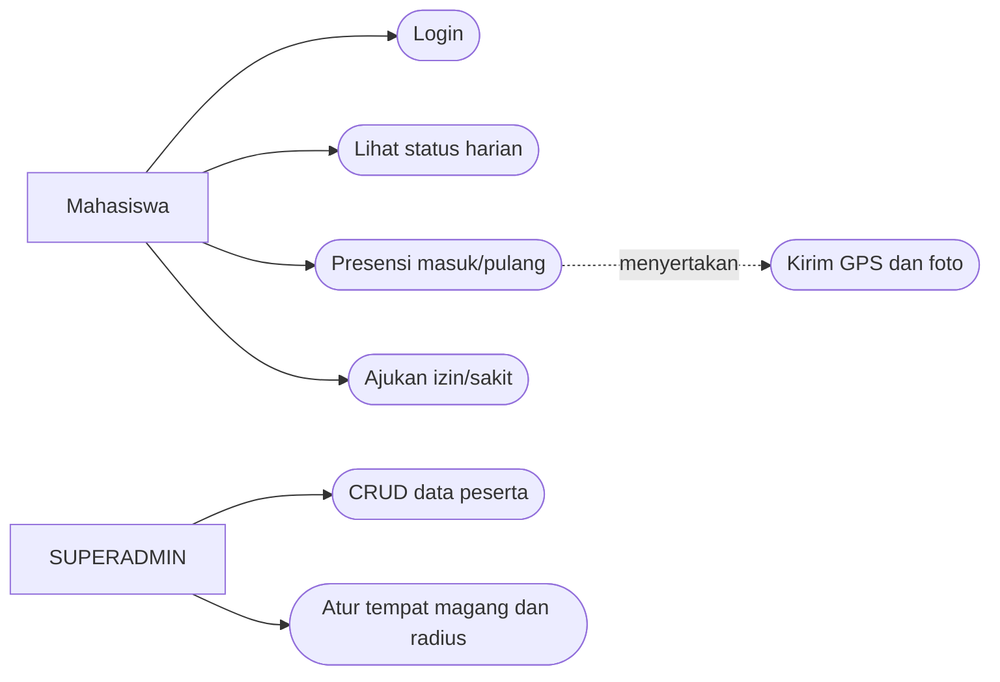
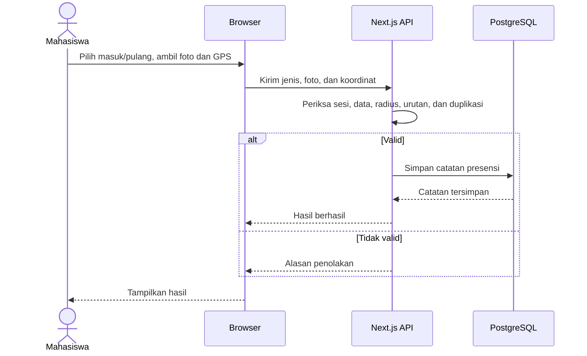
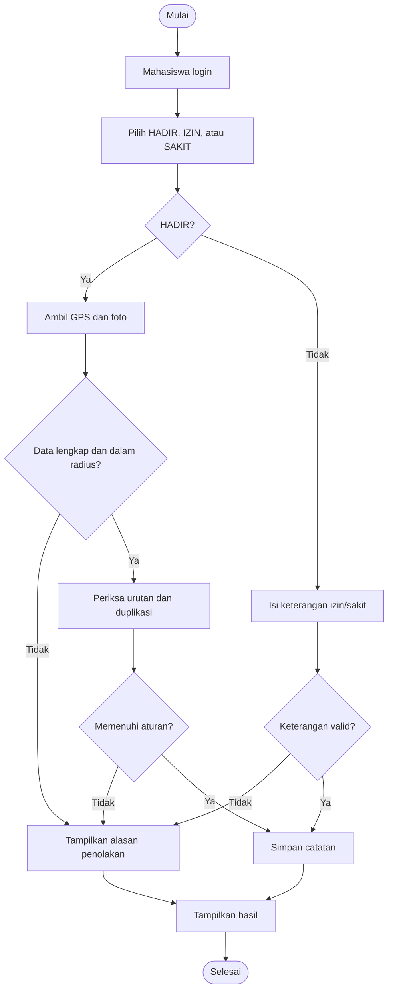
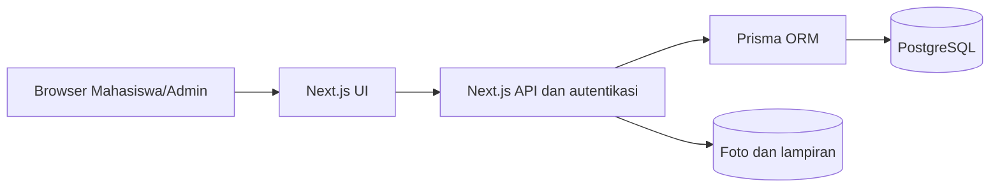

# SIMAG — Analisis dan Pengujian Sistem IF7A

**Topik:** Modul Presensi Magang Berbasis Geolokasi dan Bukti Foto pada Sistem Informasi Manajemen Magang (SIMAG)

| Identitas | Keterangan |
|---|---|
| Mata kuliah | Analisis dan Pengujian Sistem |
| Kelas | IF7A |
| Ketua kelompok | Muhammad Arif Rivandi — NIM: **23EO10005** |
| Anggota | Mohammad Alwan Abbas Abdillah — NIM: **23EO10030** |
| Anggota | Ian Alfian — NIM: **23EO1039** |
| Anggota | Fattatunnida Amalia Rahma — NIM: **23EO10010** |
| Anggota | Zainul Mutawakkil — NIM: **23EO10003** |

## 1. Deskripsi Proyek (20 poin)

Repositori ini berisi kode dan rancangan SIMAG untuk mengelola kegiatan magang. Ruang lingkup final project pada mata kuliah ini adalah **presensi mahasiswa berbasis lokasi dan foto**, serta **pengelolaan data peserta dan tempat magang oleh Admin**. Masalah yang ditangani adalah pencatatan masuk/pulang, pembuktian lokasi dalam radius tempat magang, pengajuan izin/sakit, dan pencegahan data presensi yang tidak lengkap atau ganda.

SIMAG bukan program sederhana; sistem ini memiliki autentikasi, beberapa role, API, penyimpanan PostgreSQL, dan modul administrasi. Fokus pengujian tetap dibatasi pada alur presensi dan CRUD peserta. Lima role pada skema adalah `SUPERADMIN`, `KAPRODI`, `DPL`, `MENTOR_INSTANSI`, dan `MAHASISWA`. Dua aktor utama untuk alur yang dibahas adalah **Mahasiswa** dan **SUPERADMIN**; kemampuan role lain belum seluruhnya diverifikasi.

## 2. Desain Proyek (UML) (20 poin)

### Use case

| Aktor | Use case dalam ruang lingkup |
|---|---|
| Mahasiswa | Login, melihat status harian, presensi masuk/pulang, mengirim lokasi dan foto, mengajukan izin/sakit. |
| SUPERADMIN | Melihat/mencari, menambah, mengubah, dan menghapus atau menonaktifkan peserta; mengatur tempat magang serta radius presensi. |

Pada presensi `HADIR`, pengiriman foto dan koordinat adalah bagian wajib dari alur. DPL, Kaprodi, dan Mentor tercatat sebagai role sistem, tetapi tidak diberi operasi presensi mahasiswa yang belum dibuktikan.

### Sequence diagram — presensi HADIR

### Activity diagram — presensi

**Status:** diagram menjelaskan rancangan dan aturan target. Tidak semua cabang sudah lulus pengujian dengan perangkat nyata.

## 3. Arsitektur Proyek (20 poin)

Browser mengambil input dan izin GPS/kamera. API memvalidasi sesi, peran, koordinat, radius, serta aturan presensi sebelum menyimpan metadata melalui Prisma. File bukti disimpan terpisah dari PostgreSQL. Untuk pengembangan lokal, Docker Compose memetakan port host **3391** ke port aplikasi **3200** dan menjalankan PostgreSQL sebagai service tersendiri.

## 4. Tech Stack (20 poin)

| Lapisan | Teknologi yang dipakai |
|---|---|
| Frontend | Next.js 16, React 19, TypeScript, Tailwind CSS 4 |
| Backend/API | Next.js App Router dan Route Handlers, NextAuth untuk sesi web |
| Database | PostgreSQL 16, Prisma ORM 7 |
| Penyimpanan bukti | Volume file lokal pada Docker untuk foto/lampiran |
| Pengembangan | Node.js 22 pada image Docker, Docker Compose, Git/GitHub |

Contoh Flutter, Go, MongoDB, dan Supabase pada template tugas **bukan** stack proyek ini.

## 5. Repositori, Pengujian, dan Demo UTS (20 poin)

- Repositori: [Heat4Cliff/simag-bmkg-web](https://github.com/Heat4Cliff/simag-bmkg-web).
- Ketua kelompok bertanggung jawab mengunggah versi yang disepakati dan memimpin demonstrasi UTS.
- Bukti lokal yang telah dicatat: **8/8 unit test** dan **9/9 pemeriksaan smoke API** lulus. Smoke test mencakup CRUD peserta, penolakan presensi tanpa GPS, dan penolakan lokasi di luar radius.
- Pemeriksaan yang masih diperlukan: presensi di dalam radius dengan GPS dan kamera nyata, interaksi UI Admin, serta hak akses seluruh lima role.

Alur demo: jalankan aplikasi melalui Docker di `http://localhost:3391`, tampilkan role dan data dummy, jelaskan diagram, demonstrasikan CRUD peserta serta validasi presensi yang sudah teruji, lalu tunjukkan hasil uji dan batasnya. Status **PASS** pada pengujian lokal tidak berarti seluruh fitur SIMAG telah lulus uji.
