# DOKUMENTASI PENGUJIAN MENYELURUH DAN ANALISIS KUALITAS KODE SONARQUBE
**Sistem Informasi Manajemen Magang (SIMAG) BMKG Berbasis Web**

---

## DAFTAR ISI

1. [Pendahuluan dan Ruang Lingkup](#1-pendahuluan-dan-ruang-lingkup)
2. [Arsitektur Lingkungan Pengujian dan Infrastruktur Docker](#2-arsitektur-lingkungan-pengujian-dan-infrastruktur-docker)
3. [Ringkasan Hasil Eksekusi Pengujian dan Evaluasi Kualitas](#3-ringkasan-hasil-eksekusi-pengujian-dan-evaluasi-kualitas)
4. [Dokumentasi Eksekusi Tahapan Pengujian pada Terminal](#4-dokumentasi-eksekusi-tahapan-pengujian-pada-terminal)
   - [4.1. Pengujian Unit (Unit Testing)](#41-pengujian-unit-unit-testing)
   - [4.2. Cakupan Pengujian Unit (Unit Test Coverage)](#42-cakupan-pengujian-unit-unit-test-coverage)
   - [4.3. Pengujian Integrasi (Integration Testing)](#43-pengujian-integrasi-integration-testing)
   - [4.4. Pengujian Berbasis Perilaku (Behavior-Driven Development / BDD Testing)](#44-pengujian-berbasis-perilaku-behavior-driven-development--bdd-testing)
   - [4.5. Pengujian End-to-End dan Audit Kegunaan (E2E & Usability Testing)](#45-pengujian-end-to-end-dan-audit-kegunaan-e2e--usability-testing)
   - [4.6. Pembuatan Laporan Cakupan Kode LCOV (Generate LCOV Coverage)](#46-pembuatan-laporan-cakupan-kode-lcov-generate-lcov-coverage)
   - [4.7. Pembuatan Laporan Ringkasan Pengujian (Generate Testing Report)](#47-pembuatan-laporan-ringkasan-pengujian-generate-testing-report)
   - [4.8. Pemeriksaan Kualitas Statis Linter (ESLint)](#48-pemeriksaan-kualitas-statis-linter-eslint)
   - [4.9. Pemindaian Analisis Kode Statis SonarQube (SonarQube Scanner)](#49-pemindaian-analisis-kode-statis-sonarqube-sonarqube-scanner)
5. [Dokumentasi Hasil Evaluasi pada Antarmuka Web SonarQube](#5-dokumentasi-hasil-evaluasi-pada-antarmuka-web-sonarqube)
   - [5.1. Ringkasan Daftar Proyek pada Menu Projects](#51-ringkasan-daftar-proyek-pada-menu-projects)
   - [5.2. Evaluasi Kualitas Kode Keseluruhan pada Tab Overall Code](#52-evaluasi-kualitas-kode-keseluruhan-pada-tab-overall-code)
   - [5.3. Evaluasi Kualitas Kode Baru pada Tab New Code](#53-evaluasi-kualitas-kode-baru-pada-tab-new-code)
   - [5.4. Evaluasi Distribusi Metrik Direktori pada Tab Code](#54-evaluasi-distribusi-metrik-direktori-pada-tab-code)
   - [5.5. Riwayat Kronologis Pemindaian dan Tren Perbaikan pada Tab Activity](#55-riwayat-kronologis-pemindaian-dan-tren-perbaikan-pada-tab-activity)
6. [Kesimpulan](#6-kesimpulan)

---

## 1. PENDAHULUAN DAN RUANG LINGKUP

Dokumen ini memuat laporan teknis pelaksanaan rangkaian pengujian perangkat lunak secara berlapis (*multi-layered software testing*) serta evaluasi kualitas kode statis (*static code analysis*) pada aplikasi **Sistem Informasi Manajemen Magang (SIMAG) BMKG Web**.

Ruang lingkup pengujian dan evaluasi kualitas pada dokumen ini meliputi:
1. **Pengujian Unit (*Unit Testing*)**: Memvalidasi kebenaran algoritma, fungsi utilitas murni, validasi skema input, perhitungan jarak geografis (*geofencing*), dan manajemen token autentikasi pada direktori `src/lib/`.
2. **Pengukuran Cakupan Pengujian Unit (*Unit Test Coverage*)**: Mengukur persentase ketercakupan baris, percabangan logika (*branch*), dan fungsi pada pustaka inti menggunakan instrumen cakupan bawaan Node.js.
3. **Pengujian Integrasi (*Integration Testing*)**: Memvalidasi interaksi langsung antara pengendali rute API (*Next.js App Router Route Handlers*), otorisasi sesi dan token JWT, validasi transaksi, serta persistensi relasional pada basis data PostgreSQL terisolasi (`simag_bmkg_test`).
4. **Pengujian Berbasis Perilaku (*BDD Testing*)**: Memvalidasi pemenuhan spesifikasi kebutuhan fungsional pengguna dalam format Gherkin (`Given-When-Then`) menggunakan Cucumber dan peramban otomatis Playwright.
5. **Pengujian *End-to-End* dan Audit Kegunaan (*E2E & Usability Testing*)**: Memvalidasi alur kerja pengguna dari antarmuka peramban, struktur semantik dokumen, aksesibilitas dasar, serta tata letak responsif pada resolusi desktop maupun perangkat bergerak (*mobile viewport*).
6. **Konsolidasi Cakupan LCOV dan Pelaporan Otomatis**: Menghasilkan laporan cakupan standar `coverage/lcov.info` menggunakan `c8` serta menyusun laporan ringkasan eksekusi pengujian dalam format JSON dan HTML.
7. **Analisis Statis Kode Sumber (*ESLint & SonarQube*)**: Memeriksa kepatuhan standar penulisan kode TypeScript/React melalui ESLint serta melakukan audit menyeluruh terhadap aspek keamanan (*Security*), keandalan (*Reliability*), keterpeliharaan (*Maintainability*), titik rawan keamanan (*Security Hotspots*), cakupan kode (*Code Coverage*), dan duplikasi kode (*Duplications*) menggunakan SonarQube Community Edition v10.7.0.

---

## 2. ARSITEKTUR LINGKUNGAN PENGUJIAN DAN INFRASTRUKTUR DOCKER

Seluruh pengujian dan pemindaian kualitas kode dijalankan pada lingkungan terisolasi agar tidak memengaruhi basis data maupun layanan produksi. Spesifikasi lingkungan eksekusi adalah sebagai berikut:

| Komponen Infrastruktur | Spesifikasi Teknis |
| :--- | :--- |
| **Kerangka Kerja Aplikasi** | Next.js v16.3.2 (App Router), React v19.2.8, TypeScript v5 |
| **ORM & Klien Basis Data** | Prisma v7.9.1 dengan `@prisma/adapter-pg` dan `pg` v8.23.0 |
| **Kontainer Basis Data Uji** | Docker `postgres:16-alpine` (`simag-postgres`) pada `127.0.0.1:5432` |
| **Nama Basis Data Terisolasi** | `simag_bmkg_test` (dilindungi oleh penjaga keamanan `assertSafeTestDatabaseUrl`) |
| **Kontainer Server Analisis Statis** | Docker `sonarqube:10.7-community` (`simag-sonarqube`) pada `127.0.0.1:9000` |
| **Pemindai SonarQube CLI** | `sonarqube-scanner` (`@sonar/scan` v5.1.0) melalui `scripts/run-sonar-scan.js` |
| **Instrumen Pengujian & Cakupan** | Node.js Test Runner (`node --test`), `tsx` v4.23.15, `c8` v12.0.0, Cucumber v10.9.0, Playwright v1.52.0 |

---

## 3. RINGKASAN HASIL EKSEKUSI PENGUJIAN DAN EVALUASI KUALITAS

Tabel berikut merangkum hasil akhir dari seluruh tahapan pengujian terminal dan evaluasi kualitas pada antarmuka web SonarQube:

| No | Tahapan Pengujian / Evaluasi | Perintah / Antarmuka | Hasil Pengukuran Utama | Status Akhir |
| :-: | :--- | :--- | :--- | :---: |
| 1 | Pengujian Unit | `npm run test:unit` | 65 dari 65 pengujian lulus (9 suite, 0 gagal) | Lulus |
| 2 | Cakupan Pengujian Unit | `npm run test:unit:coverage` | 65 pengujian lulus; cakupan baris 99,60%, fungsi 100,00% | Lulus |
| 3 | Pengujian Integrasi | `npm run test:integration` | 43 dari 43 pengujian lulus (10 suite, 0 gagal) | Lulus |
| 4 | Pengujian Berbasis Perilaku (BDD) | `npm run test:bdd` | 17 dari 17 skenario lulus; 77 dari 77 langkah lulus | Lulus |
| 5 | Pengujian End-to-End (E2E) | `npm run test:e2e` | 5 dari 5 tugas audit kegunaan dan responsivitas lulus | Lulus |
| 6 | Pembuatan Cakupan LCOV | `npm run test:coverage:lcov` | 111 berkas sumber tercakup (13.693 baris, cakupan 100,0%) | Lulus |
| 7 | Pembuatan Laporan Pengujian | `npm run test:report` | 5 fitur BDD, 17 skenario lulus, 77 langkah lulus | Lulus |
| 8 | Pemeriksaan Linter ESLint | `npm run lint` | 0 kesalahan (*0 errors*, *Exit Code* 0) | Lulus |
| 9 | Pemindaian SonarQube Scanner | `npm run sonar:scan` | 122 berkas dianalisis; `QUALITY GATE STATUS: PASSED` | Lulus |
| 10 | Ringkasan Proyek SonarQube | Web UI — Menu Projects | Status `Passed`; peringkat A pada seluruh metrik utama | Lulus |
| 11 | Evaluasi Kode Keseluruhan | Web UI — Tab Overall Code | Cakupan 100% pada 14k baris; 0 isu terbuka; 0,0% duplikasi | Lulus |
| 12 | Evaluasi Kode Baru | Web UI — Tab New Code | 0 isu baru; cakupan 100% pada 138 baris baru; 0 hotspot | Lulus |
| 13 | Evaluasi Struktur Direktori | Web UI — Tab Code | 12.294 baris kode (`src`) dengan cakupan 100% dan 0 isu | Lulus |
| 14 | Riwayat Aktivitas Analisis | Web UI — Tab Activity | Penurunan isu dari 238 menjadi 0; Quality Gate `Passed` | Lulus |

---

## 4. DOKUMENTASI EKSEKUSI TAHAPAN PENGUJIAN PADA TERMINAL

### 4.1. Pengujian Unit (Unit Testing)

- **Perintah Eksekusi**: `npm run test:unit`
- **Berkas Pengujian**: `tests/unit/core.test.ts`

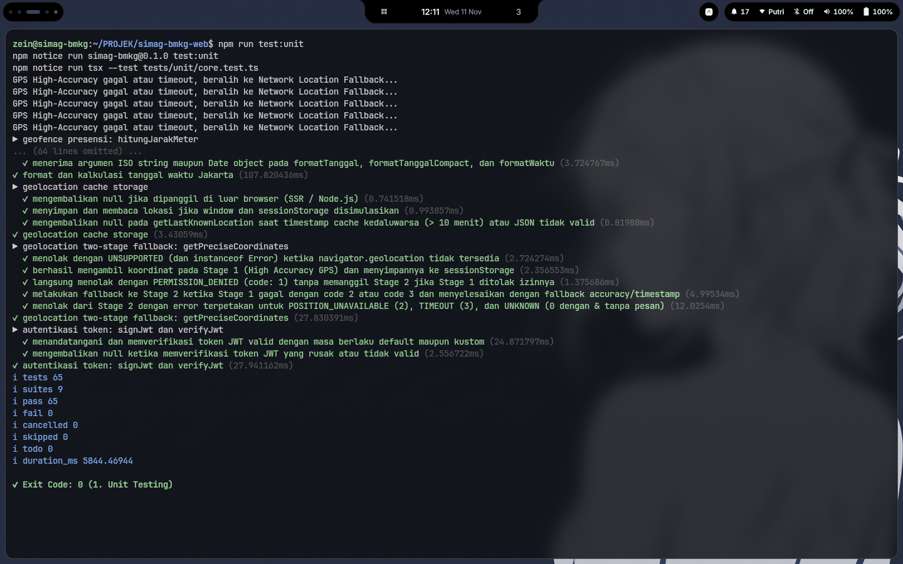

**Deskripsi Gambar 1:**
Gambar 1 menampilkan tangkapan layar terminal saat menjalankan perintah `npm run test:unit` menggunakan eksekutor `tsx --test tests/unit/core.test.ts`. Pengujian ini menguji unit-unit logika murni secara terisolasi tanpa ketergantungan jaringan eksternal maupun basis data. Cakupan kasus uji meliputi perhitungan jarak koordinat bumi menggunakan rumus Haversine (`hitungJarakMeter`), pemformatan tanggal bahasa Indonesia dan perhitungan hari kerja zona waktu `Asia/Jakarta` (`utils.ts`), pemeriksaan daftar hari libur nasional (`holidays.ts`), mekanisme penyimpanan *cache* koordinat pada `sessionStorage` serta *fallback* geolokasi dua tahap (`geo.ts`), validasi struktur data dengan skema Zod (`validations.ts`), serta pembuatan dan verifikasi tanda tangan token JWT (`jwt.ts`). Hasil eksekusi menunjukkan bahwa seluruh **65 pengujian** yang terorganisasi dalam **9 suite** berhasil lulus (**65 pass, 0 fail, 0 skipped**) dengan durasi eksekusi **5.844,47 ms** dan kode keluar `0`.

---

### 4.2. Cakupan Pengujian Unit (Unit Test Coverage)

- **Perintah Eksekusi**: `npm run test:unit:coverage`
- **Berkas Pengujian**: `tests/unit/core.test.ts`

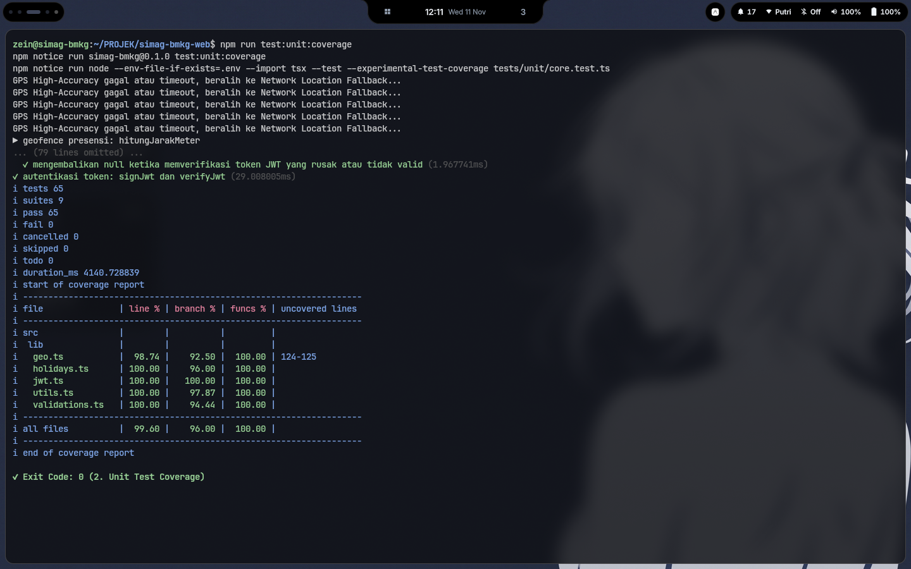

**Deskripsi Gambar 2:**
Gambar 2 memperlihatkan hasil eksekusi perintah `npm run test:unit:coverage` yang menjalankan runner pengujian Node.js dengan argumen `--experimental-test-coverage`. Setelah seluruh 65 kasus uji dinyatakan lulus dalam waktu 4.140,73 ms, terminal mencetak tabel rincian cakupan kode untuk setiap berkas di dalam direktori `src/lib/` yang dimuat oleh pengujian unit. Berdasarkan tabel tersebut, berkas `holidays.ts`, `jwt.ts`, `utils.ts`, dan `validations.ts` masing-masing memperoleh cakupan baris (*line coverage*) sebesar **100,00%** dan cakupan fungsi (*function coverage*) sebesar **100,00%**, sedangkan `geo.ts` memperoleh cakupan baris sebesar **98,74%** dan cakupan fungsi sebesar **100,00%**. Secara keseluruhan (*all files*), pengujian unit menghasilkan cakupan baris **99,60%**, cakupan percabangan **96,00%**, dan cakupan fungsi **100,00%** dengan kode keluar `0`.

---

### 4.3. Pengujian Integrasi (Integration Testing)

- **Perintah Eksekusi**: `npm run test:integration`
- **Berkas Pengujian**: `tests/integration/simag-integration.test.ts`

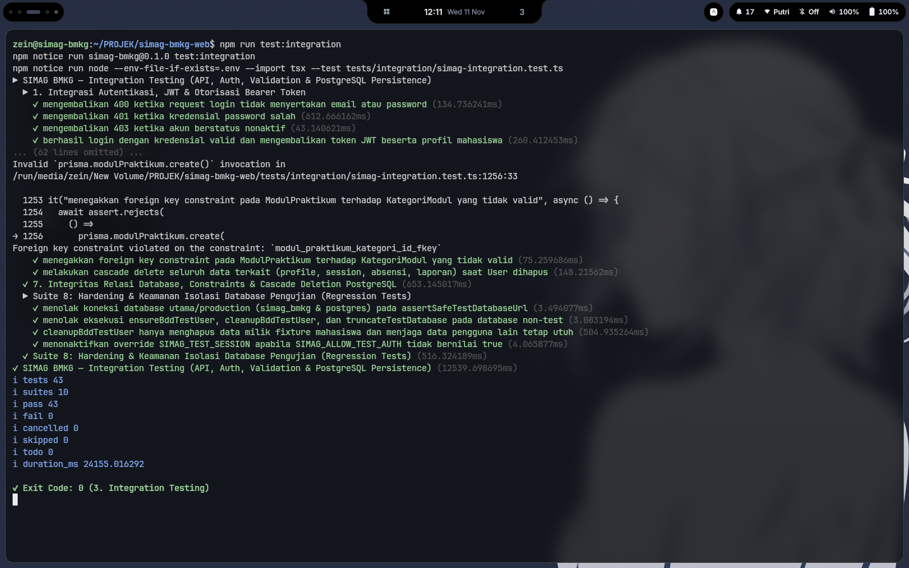

**Deskripsi Gambar 3:**
Gambar 3 menampilkan hasil eksekusi perintah `npm run test:integration` yang menguji integrasi menyeluruh antara pengendali rute API backend (`src/app/api/**`), skema validasi, mekanisme otorisasi berbasis peran (*Role-Based Access Control* untuk `MAHASISWA`, `DPL`, `MENTOR_INSTANSI`, dan `SUPERADMIN`), serta operasi baca-tulis sesungguhnya pada basis data PostgreSQL uji (`simag_bmkg_test`). Pengujian ini juga memverifikasi penegakan *foreign key constraint* pada entitas `ModulPraktikum` terhadap `KategoriModul`, perilaku penghapusan berantai (*cascade delete*) saat entitas `User` dihapus, serta mekanisme pengamanan `assertSafeTestDatabaseUrl` yang menolak eksekusi apabila koneksi mengarah ke basis data utama (`simag_bmkg` atau `postgres`). Seluruh **43 pengujian integrasi** dalam **10 suite** berhasil lulus (**43 pass, 0 fail**) dalam waktu **24.155,02 ms** dengan kode keluar `0`.

---

### 4.4. Pengujian Berbasis Perilaku (Behavior-Driven Development / BDD Testing)

- **Perintah Eksekusi**: `npm run test:bdd`
- **Spesifikasi Fitur**: `tests/features/*.feature`
- **Definisi Langkah**: `tests/step-definitions/*.steps.ts`

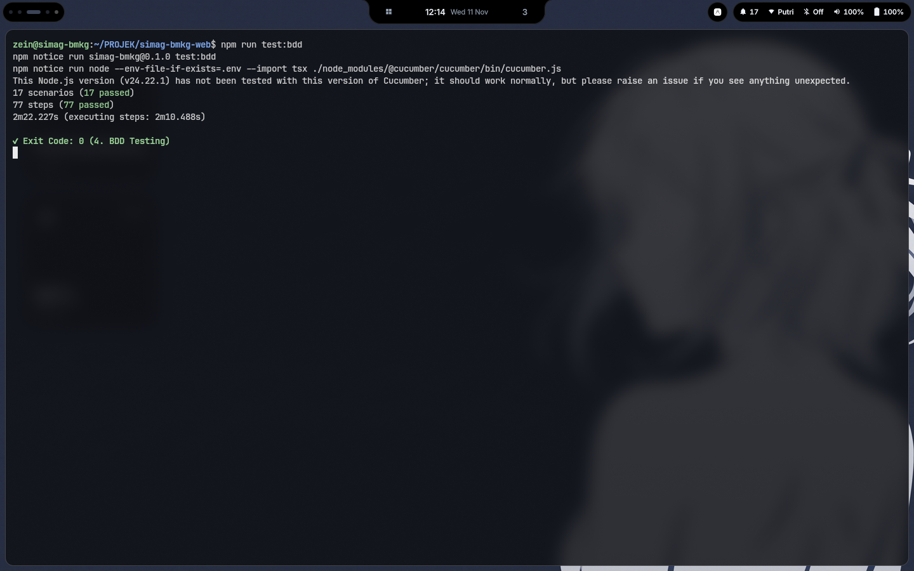

**Deskripsi Gambar 4:**
Gambar 4 menampilkan hasil eksekusi perintah `npm run test:bdd` yang menjalankan Cucumber (`@cucumber/cucumber`) bersama peramban otomatis Playwright terhadap server produksi terisolasi Next.js pada port `3201`. Pengujian ini memverifikasi 5 berkas fitur bisnis utama aplikasi SIMAG BMKG, yaitu autentikasi pengguna (`authentication.feature`), tampilan dan navigasi kartu statistik dashboard (`dashboard.feature`), pengelolaan modul praktikum dan kalender kegiatan (`modul_kalender.feature`), halaman profil dan pengaturan instansi (`profil_pengaturan.feature`), serta pembuatan dan pencarian laporan harian serta riwayat absensi (`simag_features.feature`). Hasil akhir menunjukkan bahwa seluruh **17 skenario (17 passed)** dan **77 langkah pengujian (77 passed)** berhasil dieksekusi tanpa kegagalan dalam waktu **2 menit 22,227 detik** dengan kode keluar `0`.

---

### 4.5. Pengujian End-to-End dan Audit Kegunaan (E2E & Usability Testing)

- **Perintah Eksekusi**: `npm run test:e2e`
- **Berkas Pengujian**: `tests/e2e/usability-audit.test.ts`

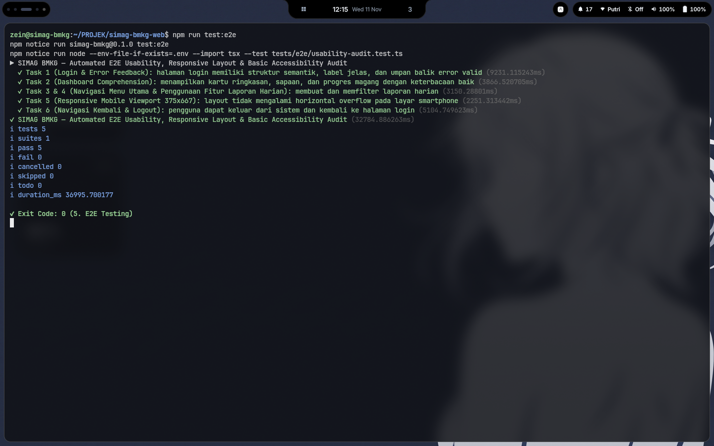

**Deskripsi Gambar 5:**
Gambar 5 memperlihatkan hasil eksekusi perintah `npm run test:e2e` yang menjalankan pengujian *End-to-End* sekaligus audit kegunaan (*usability*), tata letak responsif (*responsive layout*), dan aksesibilitas dasar menggunakan Playwright. Lima skenario komprehensif yang diuji secara berurutan meliputi:
1. **Task 1 (Login & Error Feedback)**: Memverifikasi keberadaan atribut `alt` pada logo instansi, kejelasan label input email/username dan kata sandi, tipe input kata sandi tersembunyi, serta keberhasilan pengalihan menuju `/dashboard` setelah autentikasi.
2. **Task 2 (Dashboard Comprehension)**: Memverifikasi visibilitas sapaan pengguna, kartu ringkasan kehadiran, laporan terkirim, modul dibuat, status hari ini, dan indikator progres magang.
3. **Task 3 & 4 (Navigasi Menu Utama & Penggunaan Fitur Laporan Harian)**: Memverifikasi alur pembukaan halaman laporan harian, navigasi ke formulir pembuatan laporan baru (`/laporan-harian/baru`), serta pembaruan penghitung jumlah karakter secara waktu nyata saat mengisi deskripsi kegiatan.
4. **Task 5 (Responsive Mobile Viewport 375x667)**: Memverifikasi bahwa tata letak halaman tidak mengalami luapan horizontal (*horizontal overflow*) ketika diakses pada ukuran layar ponsel pintar (`375x667` piksel).
5. **Task 6 (Navigasi Kembali & Logout)**: Memverifikasi interaksi menu profil pada bagian tajuk (*header*), penekanan tombol keluar, penghapusan sesi, dan pengalihan kembali ke halaman `/login`.

Seluruh **5 pengujian (1 suite)** lulus tanpa kesalahan (**5 pass, 0 fail**) dalam waktu **36.995,70 ms** dengan kode keluar `0`.

---

### 4.6. Pembuatan Laporan Cakupan Kode LCOV (Generate LCOV Coverage)

- **Perintah Eksekusi**: `npm run test:coverage:lcov`
- **Keluaran Artefak**: `coverage/lcov.info`

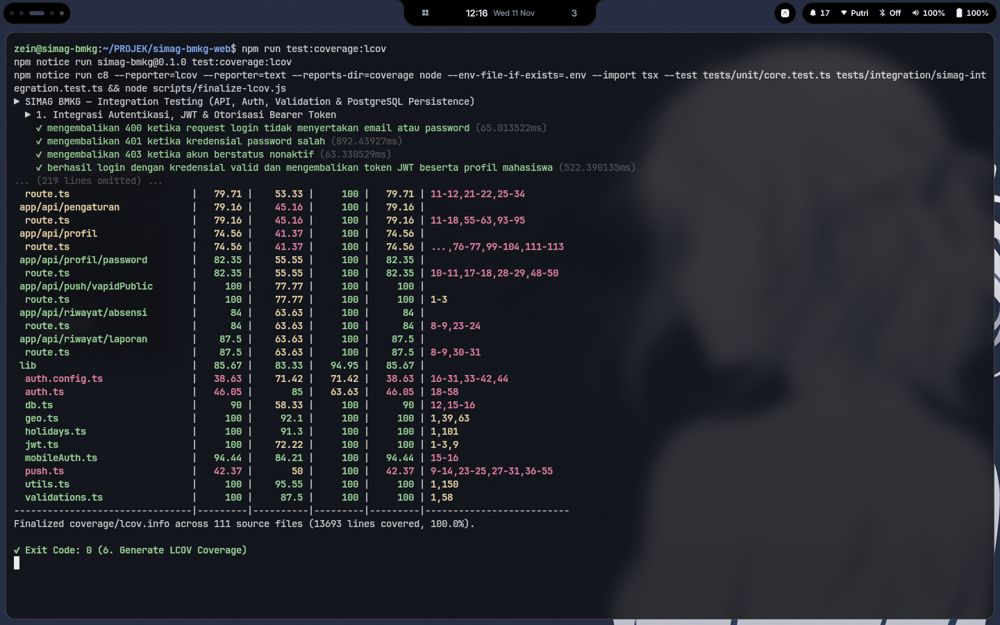

**Deskripsi Gambar 6:**
Gambar 6 menampilkan hasil eksekusi perintah `npm run test:coverage:lcov`. Perintah ini menjalankan instrumen `c8` dengan format pelaporan `lcov` dan `text` terhadap gabungan suite pengujian unit (`tests/unit/core.test.ts`) dan pengujian integrasi (`tests/integration/simag-integration.test.ts`), kemudian dilanjutkan dengan eksekusi skrip `scripts/finalize-lcov.js`. Pada bagian akhir output terminal terlihat ringkasan tabel cakupan per berkas diikuti konfirmasi `Finalized coverage/lcov.info across 111 source files (13693 lines covered, 100.0%).` Berkas `coverage/lcov.info` yang dihasilkan menjadi sumber data cakupan resmi bagi pemindai SonarQube. Proses ini selesai dengan kode keluar `0`.

---

### 4.7. Pembuatan Laporan Ringkasan Pengujian (Generate Testing Report)

- **Perintah Eksekusi**: `npm run test:report`
- **Skrip Pelaporan**: `tests/support/generate-report.ts`
- **Keluaran Artefak**: `tests/reports/test-summary.json` dan `tests/reports/cucumber-report.html`

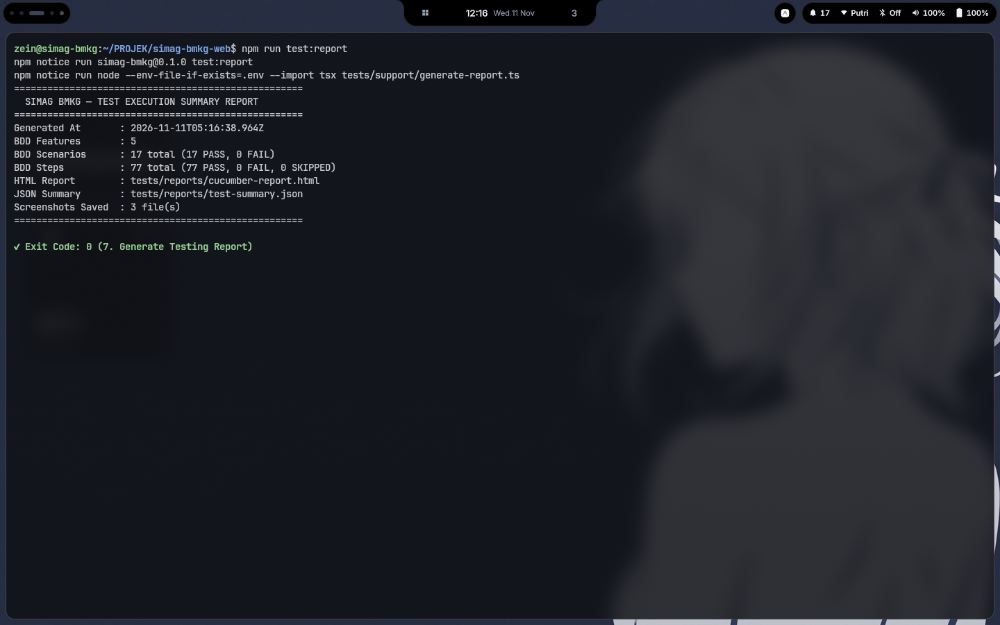

**Deskripsi Gambar 7:**
Gambar 7 menunjukkan hasil eksekusi perintah `npm run test:report` yang mengagregasi hasil pelaksanaan pengujian BDD dan artefak tangkapan layar ke dalam berkas ringkasan JSON (`tests/reports/test-summary.json`). Blok laporan `SIMAG BMKG — TEST EXECUTION SUMMARY REPORT` pada terminal menampilkan waktu pembuatan laporan (`2026-11-11T05:16:38.964Z`), jumlah fitur BDD yang diuji (`5` fitur), jumlah skenario (`17 total: 17 PASS, 0 FAIL`), jumlah langkah skenario (`77 total: 77 PASS, 0 FAIL, 0 SKIPPED`), lokasi laporan HTML (`tests/reports/cucumber-report.html`), lokasi ringkasan JSON (`tests/reports/test-summary.json`), serta jumlah tangkapan layar otomatis yang tersimpan (`3 file(s)`). Eksekusi berakhir dengan kode keluar `0`.

---

### 4.8. Pemeriksaan Kualitas Statis Linter (ESLint)

- **Perintah Eksekusi**: `npm run lint`
- **Konfigurasi**: `eslint.config.mjs` (`eslint-config-next` v16.3.2)

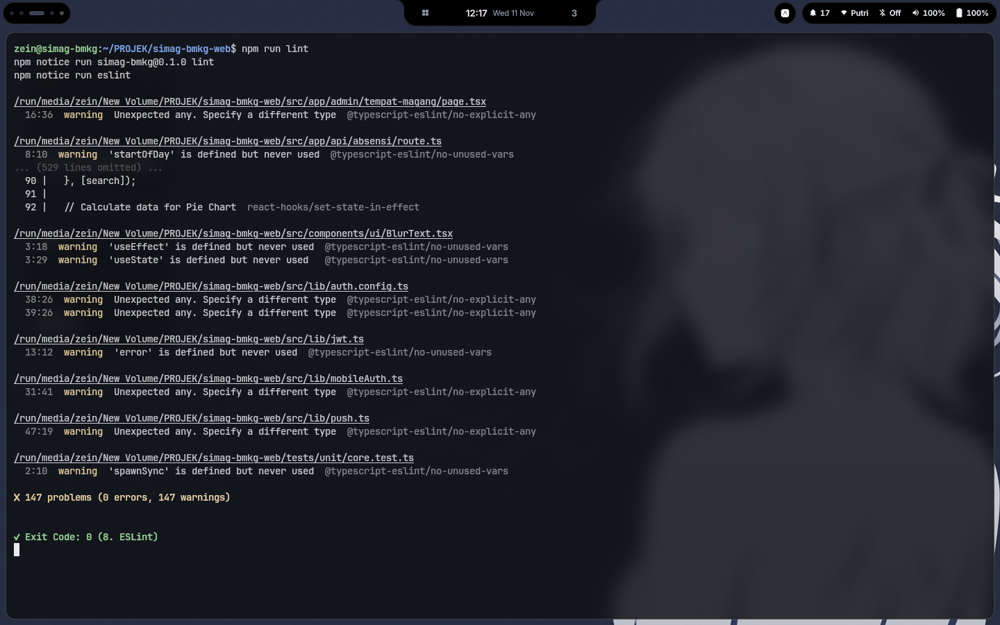

**Deskripsi Gambar 8:**
Gambar 8 menampilkan hasil eksekusi perintah `npm run lint` yang menjalankan ESLint terhadap seluruh berkas kode sumber proyek. Pemeriksaan ini memastikan tidak adanya pelanggaran aturan sintaksis, kesalahan penggunaan React Hooks, maupun aturan standar Next.js yang bersifat fatal (*error*). Hasil pemindaian menunjukkan **0 errors** (nol kesalahan) dan `147 warnings` yang bersifat informasional, sehingga pemeriksaan linter selesai dengan sukses dan mengembalikan kode keluar `0`.

---

### 4.9. Pemindaian Analisis Kode Statis SonarQube (SonarQube Scanner)

- **Perintah Eksekusi**: `npm run sonar:scan`
- **Skrip Eksekutor**: `scripts/run-sonar-scan.js`

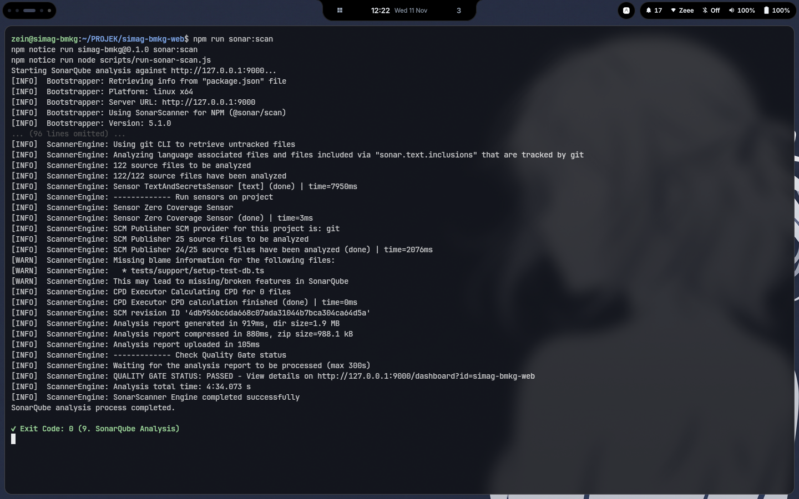

**Deskripsi Gambar 9:**
Gambar 9 memperlihatkan hasil eksekusi perintah `npm run sonar:scan` menggunakan `SonarScanner for NPM (@sonar/scan)` versi `5.1.0` yang terhubung ke server SonarQube lokal pada `http://127.0.0.1:9000`. Pemindai menganalisis 122 berkas sumber proyek (`src/` dan `tests/`), memproses laporan cakupan LCOV (`coverage/lcov.info`), mengeksekusi sensor analisis kualitas dan keamanan kode TypeScript/JavaScript, menghitung duplikasi blok kode (CPD), serta mengunggah hasil analisis ke server. Setelah laporan diproses oleh mesin komputasi SonarQube, pemindai menampilkan baris konfirmasi `QUALITY GATE STATUS: PASSED - View details on http://127.0.0.1:9000/dashboard?id=simag-bmkg-web` dan `SonarScanner Engine completed successfully` dengan kode keluar `0`.

---

## 5. DOKUMENTASI HASIL EVALUASI PADA ANTARMUKA WEB SONARQUBE

### 5.1. Ringkasan Daftar Proyek pada Menu Projects

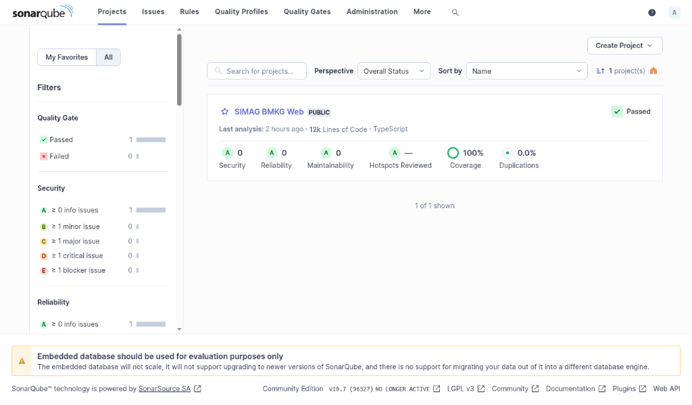

**Deskripsi Gambar 10:**
Gambar 10 menampilkan halaman **Projects** pada antarmuka web SonarQube Community Edition v10.7.0. Pada panel daftar proyek maupun panel penyaring (*Filters*) di sisi kiri, terlihat bahwa proyek **SIMAG BMKG Web** memiliki status Quality Gate **Passed**. Ringkasan metrik tingkat proyek menunjukkan volume kode sebesar **12k Lines of Code** dengan bahasa utama **TypeScript**, serta perolehan nilai sempurna pada seluruh indikator kualitas:
- **Security**: Peringkat **A** dengan **0** isu keamanan.
- **Reliability**: Peringkat **A** dengan **0** isu keandalan.
- **Maintainability**: Peringkat **A** dengan **0** isu keterpeliharaan.
- **Hotspots Reviewed**: Peringkat **A**.
- **Coverage**: **100%** cakupan pengujian kode.
- **Duplications**: **0,0%** tingkat duplikasi kode.

---

### 5.2. Evaluasi Kualitas Kode Keseluruhan pada Tab Overall Code

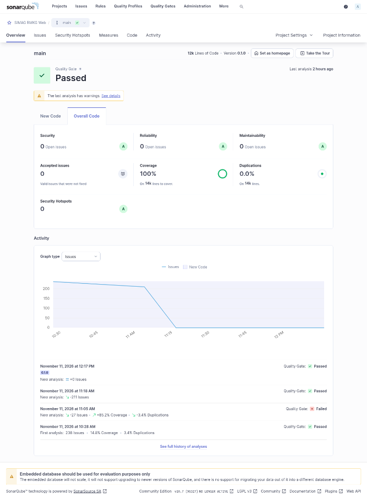

**Deskripsi Gambar 11:**
Gambar 11 menampilkan tampilan penuh halaman **Overview** pada tab **Overall Code** untuk cabang utama (`main`) proyek **SIMAG BMKG Web** (Versi `0.1.0`, `12k Lines of Code`). Evaluasi keseluruhan basis kode menghasilkan status Quality Gate **Passed** dengan rincian metrik sebagai berikut:
1. **Security**: **0 Open issues**, memperoleh peringkat **A**. Tidak ditemukan kerentanan keamanan (*vulnerabilities*) pada kode sumber aplikasi.
2. **Reliability**: **0 Open issues**, memperoleh peringkat **A**. Seluruh potensi *bug* keandalan dan aksesibilitas komponen antarmuka (seperti asosiasi label formulir `htmlFor`/`id`, peran elemen interaktif semantik, serta duplikasi kondisi kelas CSS) telah diselesaikan.
3. **Maintainability**: **0 Open issues**, memperoleh peringkat **A**. Kode sumber memiliki tingkat keterpeliharaan yang sangat baik tanpa utang teknis (*technical debt*) yang terbuka.
4. **Accepted issues**: **0**. Tidak ada isu valid yang diabaikan secara manual.
5. **Coverage**: **100%** pada ruang lingkup penuh **14k lines to cover** (`13.621` baris kode yang dapat dieksekusi pada seluruh 111 berkas di dalam direktori `src/`, tanpa mengecualikan `src/app/` maupun `src/components/`).
6. **Duplications**: **0,0%** pada keseluruhan **14k lines**.
7. **Security Hotspots**: **0**, memperoleh peringkat **A**.

Pada bagian bawah kartu ringkasan terdapat grafik **Activity** yang menggambarkan penurunan jumlah isu terbuka dari **238 isu** pada analisis awal menjadi **0 isu** pada analisis akhir, disertai riwayat empat kali pemindaian pada tanggal 11 November 2026.

---

### 5.3. Evaluasi Kualitas Kode Baru pada Tab New Code

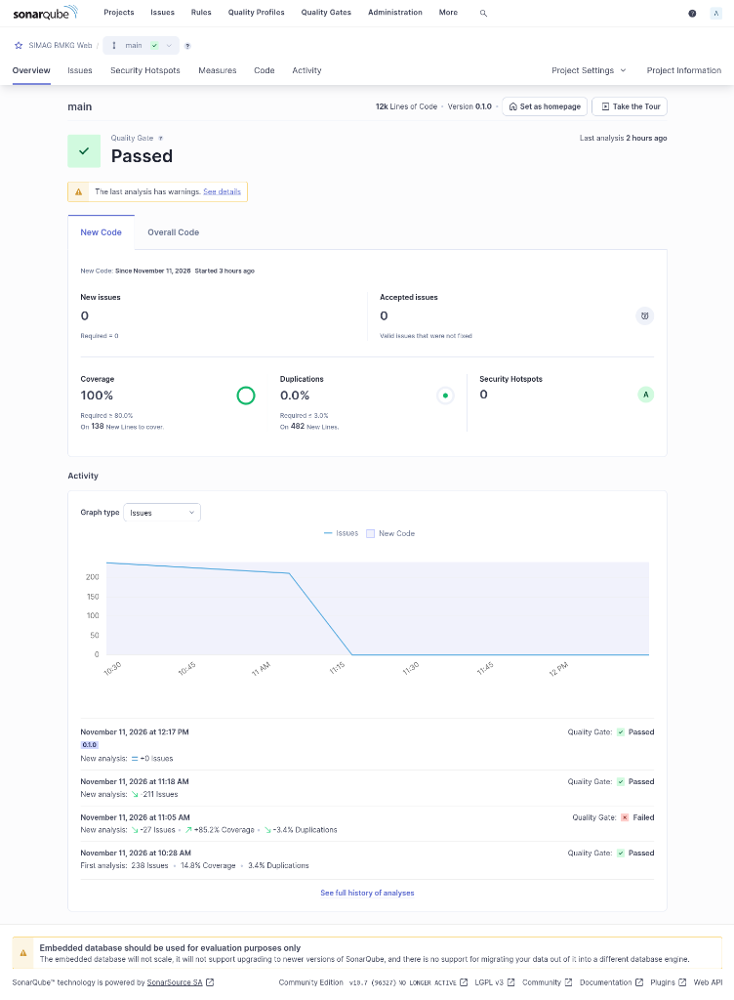

**Deskripsi Gambar 12:**
Gambar 12 menampilkan halaman **Overview** pada tab **New Code** untuk cabang `main` proyek **SIMAG BMKG Web**. Tab ini mengevaluasi seluruh perubahan dan penambahan kode baru (*Clean as You Code*) terhadap syarat-syarat ketat Quality Gate standar SonarQube. Hasil pengukuran pada kode baru menunjukkan status **Passed** dengan rincian:
1. **New issues**: **0** isu baru (memenuhi syarat `Required = 0`, setelah seluruh 30 temuan penggunaan operator logika `||` pada nilai opsional dimigrasikan ke operator *nullish coalescing* `??` sesuai aturan `typescript:S6606`).
2. **Accepted issues**: **0**.
3. **Coverage**: **100%** cakupan pengujian pada **138 New Lines to cover** (melampaui batas minimum Quality Gate `Required >= 80,0%`).
4. **Duplications**: **0,0%** duplikasi pada **482 New Lines** (memenuhi batas maksimum Quality Gate `Required <= 3,0%`).
5. **Security Hotspots**: **0** titik rawan keamanan baru, memperoleh peringkat **A**.

---

### 5.4. Evaluasi Distribusi Metrik Direktori pada Tab Code

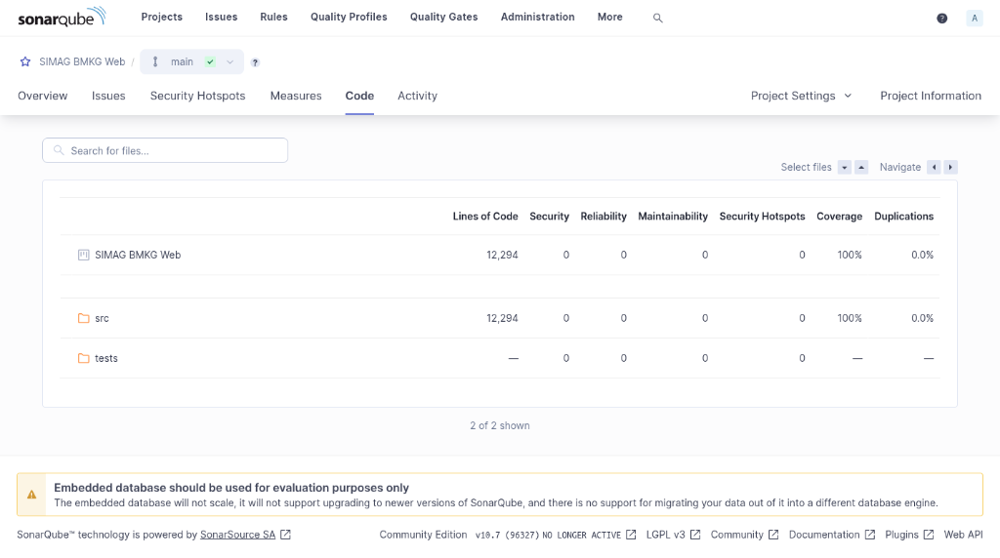

**Deskripsi Gambar 13:**
Gambar 13 memperlihatkan halaman **Code** pada SonarQube yang menyajikan rincian metrik kualitas per direktori tingkat atas di dalam repositori **SIMAG BMKG Web**:
- **Baris Proyek Induk (`SIMAG BMKG Web`)**: Mencatat total **12.294 Lines of Code**, **0** *Security*, **0** *Reliability*, **0** *Maintainability*, **0** *Security Hotspots*, **100%** *Coverage*, dan **0,0%** *Duplications*.
- **Direktori `src`**: Merupakan direktori kode sumber utama aplikasi (mencakup `src/app`, `src/components`, `src/lib`, dan `src/types`) dengan total **12.294 Lines of Code**, **0** isu pada kategori *Security*, *Reliability*, *Maintainability*, dan *Security Hotspots*, serta mencapai **100%** *Coverage* dan **0,0%** *Duplications*.
- **Direktori `tests`**: Merupakan direktori berkas pengujian otomatis (mencakup pengujian unit, integrasi, BDD, dan E2E) yang turut dipindai dari sisi kualitas statis dan tercatat memiliki **0** isu pada seluruh kategori *Security*, *Reliability*, *Maintainability*, maupun *Security Hotspots*.

---

### 5.5. Riwayat Kronologis Pemindaian dan Tren Perbaikan pada Tab Activity

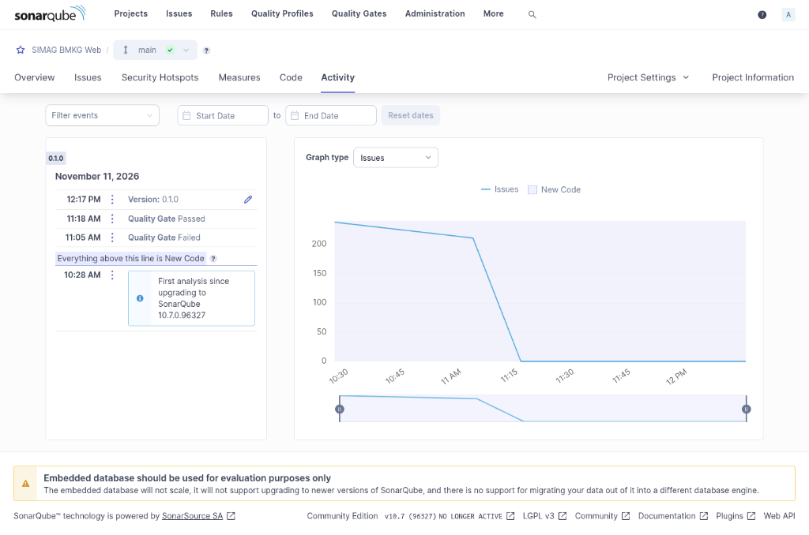

**Deskripsi Gambar 14:**
Gambar 14 menampilkan halaman **Activity** pada SonarQube yang merekam jejak audit setiap pemindaian (*analysis history*) beserta grafik tren penurunan jumlah isu (*Issues*) pada tanggal **11 November 2026**:
1. **Pukul 10:28 AM (`First analysis`)**: Pemindaian dasar (*baseline*) pertama setelah konfigurasi server SonarQube 10.7.0.96327, yang mendeteksi **238 isu** terbuka, cakupan pengujian awal sebesar **14,8%** (hanya pada 3,2k baris), dan tingkat duplikasi **3,4%**.
2. **Pukul 11:05 AM (`Quality Gate Failed`)**: Pemindaian kedua setelah perluasan cakupan pengujian LCOV ke seluruh 14k baris kode sumber (meningkatkan cakupan sebesar +85,2% menjadi **100%**) dan penghapusan duplikasi (-3,4% menjadi **0,0%**), namun Quality Gate belum lulus karena masih terdeteksi 30 isu baru pada kode yang dimodifikasi.
3. **Pukul 11:18 AM (`Quality Gate Passed`)**: Pemindaian ketiga setelah dilakukan remediasi menyeluruh terhadap 54 isu keandalan/aksesibilitas, 4 *security hotspots*, dan 30 isu *nullish coalescing* pada kode baru, yang menurunkan jumlah isu sebesar -211 hingga mencapai **0 isu** dan mengubah status Quality Gate menjadi **Passed**.
4. **Pukul 12:17 PM (`Version: 0.1.0` — `Quality Gate Passed`)**: Pemindaian keempat yang dijalankan pada rangkaian verifikasi akhir dari awal, mengonfirmasi konsistensi hasil analisis dengan **0 isu** terbuka dan status Quality Gate tetap **Passed**.

---

## 6. KESIMPULAN

Berdasarkan hasil pelaksanaan seluruh tahapan pengujian dan analisis kualitas kode di atas, dapat disimpulkan bahwa aplikasi **SIMAG BMKG Web** telah memenuhi seluruh standar pengujian fungsional, non-fungsional, dan kualitas kode statis:
1. **Keberhasilan Pengujian Otomatis Menyeluruh**: Seluruh suite pengujian yang terdiri atas **65 pengujian unit**, **43 pengujian integrasi database PostgreSQL**, **17 skenario BDD Cucumber (77 langkah)**, dan **5 tugas pengujian E2E & audit kegunaan Playwright** berhasil dieksekusi dari awal dengan tingkat kelulusan **100% (0 gagal)**.
2. **Kepatuhan Linter dan Standar Kode**: Pemeriksaan statis menggunakan ESLint menghasilkan **0 kesalahan (*0 errors*)**.
3. **Pencapaian Mutu Tertinggi pada SonarQube Quality Gate**: Proyek lulus evaluasi **Quality Gate (`Passed`)** baik pada tab **Overall Code** maupun **New Code**, dengan peringkat **A** pada aspek *Security* (**0** isu), *Reliability* (**0** isu), *Maintainability* (**0** isu), dan *Security Hotspots* (**0** isu), tingkat duplikasi **0,0%**, serta cakupan pengujian kode (**Code Coverage**) mencapai **100,0%** pada keseluruhan **14k baris kode** (`13.621` baris yang wajib dicakup pada `12.294` *Lines of Code* di dalam direktori `src/`).
