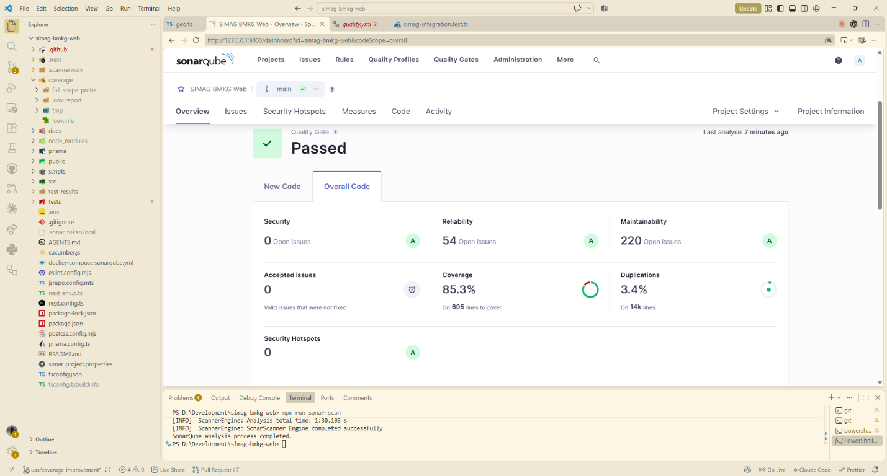

# Hasil Analisis SonarQube

## Ringkasan

Berikut hasil yang terlihat pada dashboard **SonarQube lokal** tanggal 11 November 2026:

| Metrik | Hasil |
|---|---:|
| Quality Gate | Passed |
| Security issues | 0 |
| Coverage | 85,3% pada 695 baris |
| Duplications | 3,4% pada sekitar 14 ribu baris |
| Reliability issues | 54 |
| Maintainability issues | 220 |
| Security hotspots | 0 |

## Catatan cakupan

Gambar ini merekam hasil dashboard SonarQube lokal, bukan hasil SonarQube Cloud. Coverage merupakan hasil impor laporan LCOV dari test yang dikonfigurasi untuk analisis tersebut. Nilai ini tidak berarti seluruh source code sudah tercakup; `src/app/**` dan `src/components/**` saat ini dikecualikan dari denominator coverage.

SonarQube Cloud menganalisis secara terpisah. Untuk melihat coverage di Cloud, workflow CI harus berhasil membuat `coverage/lcov.info` dan mengirimkannya ke project Cloud.
